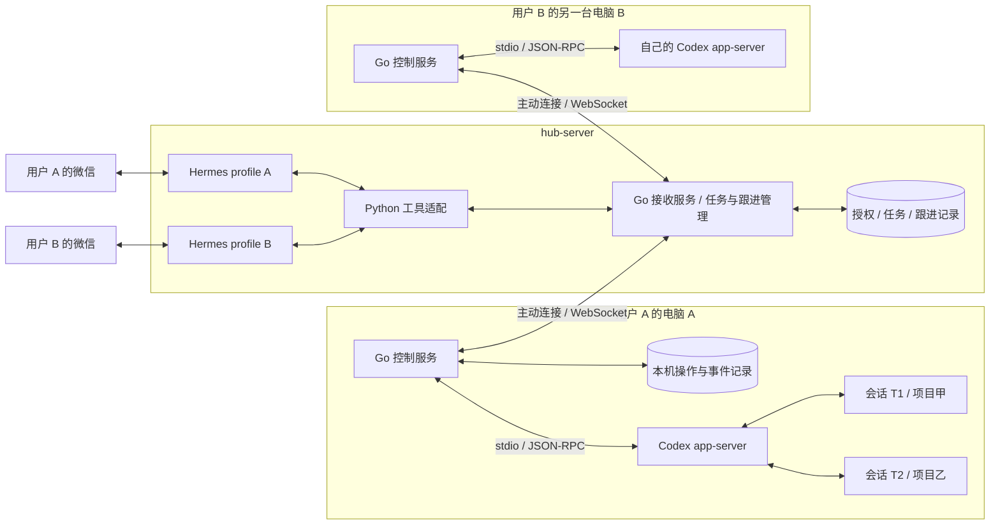
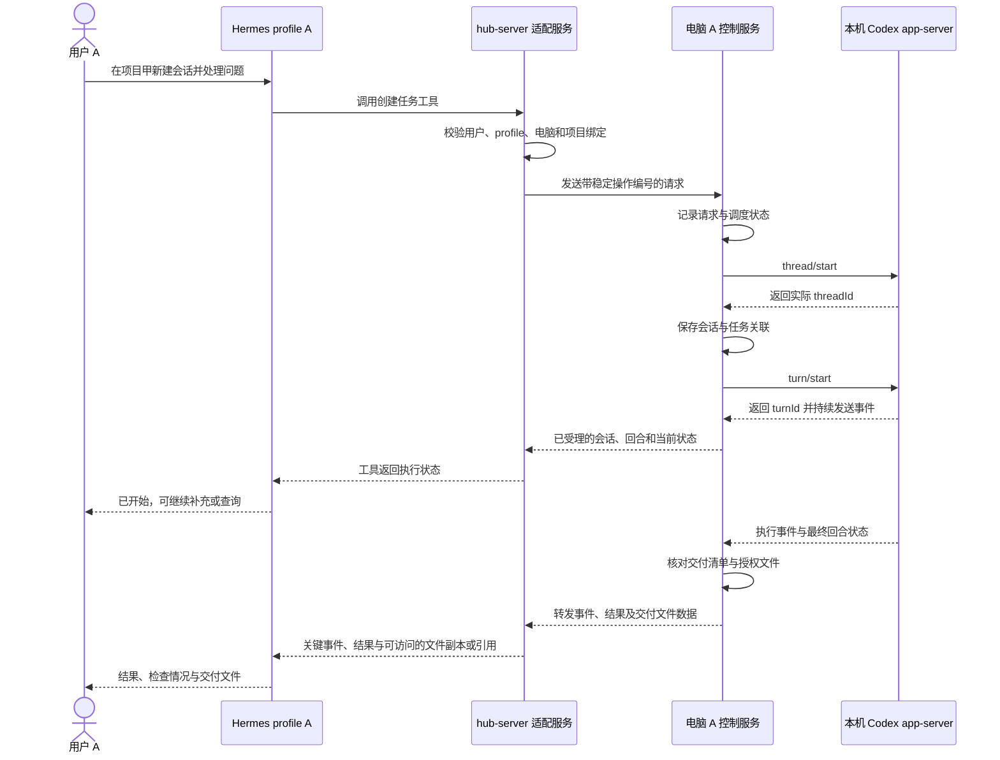
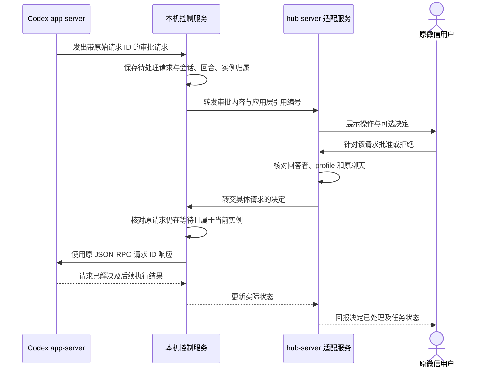
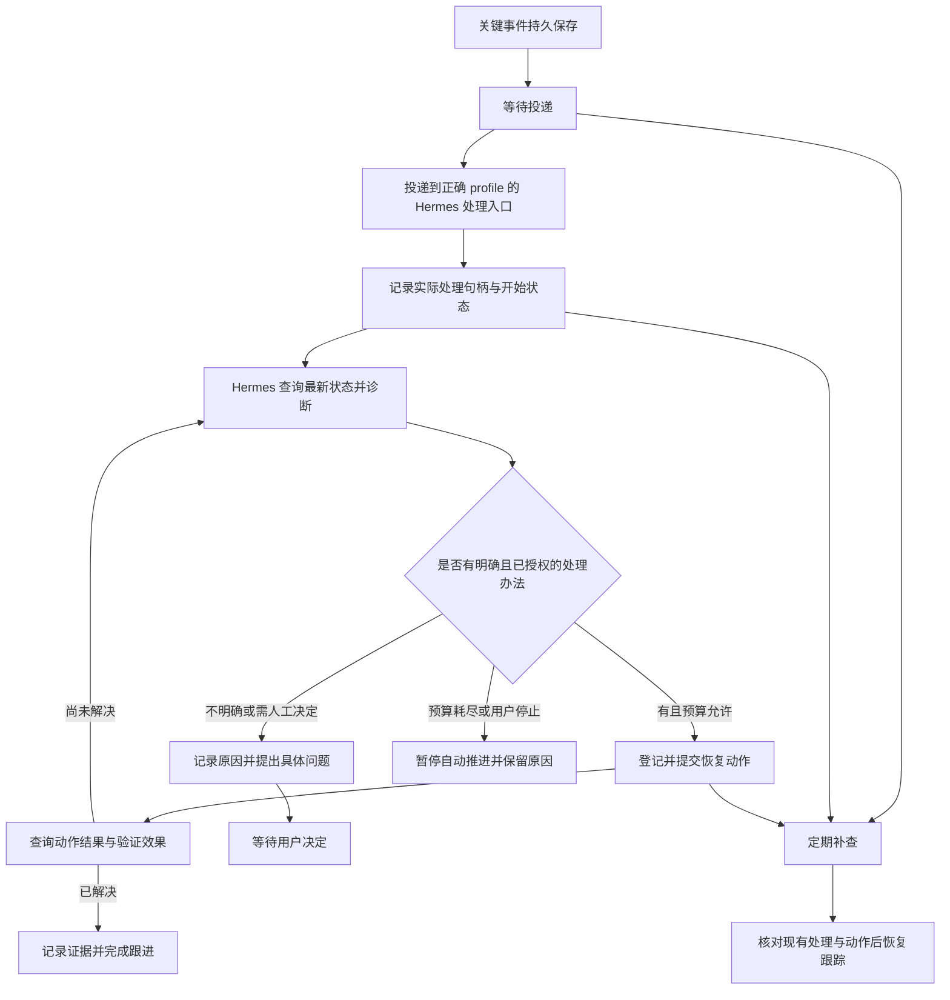

# dots-duet-lite 详细实现方案

日期：2026-10-22。状态：设计文档；项目骨架与依赖已初始化，业务流程尚未实现或部署。

本文依据 [需求](需求.md)说明从微信发出任务到结果交付的实现方式。[README](../README.md)提供项目入口。文中的机器名、profile 名、工具名、接口消息和数据库结构均为设计示例，不是已运行的配置。

## 1. 最终要做成什么

你在微信对自己的 Hermes 说：“在电脑 A 的项目甲里新建一个 Codex 会话，处理这个问题。”Hermes 找到你授权的电脑，创建会话并交代任务。任务运行时，你可以继续与 Hermes 聊天，也可以让它查询进展、补充要求、处理问题或停止当前执行。结束后，Hermes 把结果和需要交付的文件发回微信。

hub-server 上有多个 Hermes profile，每个 profile 由不同的人使用。不同用户的 Codex 在不同的电脑上运行。一个 profile 可以访问其绑定电脑上的多个已授权 Codex 会话，分别处理不同项目，也可以为同一项目建立不同会话。

第一版以“一个用户对应一个 profile、绑定一台执行电脑”为配置方式，不加入跨用户共享电脑或公共注册功能。首先验证 Windows，其他人的电脑系统和网络条件需要分别核实。

这里的“本机”指各用户实际运行 Codex 的电脑，不是 hub-server。云端协调者固定为 Hermes，负责理解目标、选择任务、检查结果和跟进；执行端负责真实执行、确定性查询和状态记录。项目修改和命令执行主要交给 Codex。控制服务另外提供产物自动回传，以及 Hermes 主动查询、读取和下载任务文件的工具，使 Hermes 可以检查与整理实际文件，而非只看到路径。

### 1.1 首版与增强的边界

首版实现需求 R01—R13：授权路由、机器就绪查询、项目选择、多会话、任务列表、追加与停止、审批与问题、异步通知、文件获取、结果核验、恢复、Hermes 集成，以及可靠唤醒和自动异常处理。最小内存原型仅用于验证，不能代替完整首版验收。

需求 E01—E08 是后续增强：完整项目卡片、搜索、日志片段、Git 查询、命令模板、打包与预览、待处理事项汇总和定时简报。先复用 Hermes 已有的会话、后台工作、委派、调度、记忆和 Skills，再补执行端接口，不建设另一套 Agent 平台。

其中 R13 的持续跟进、异常自动处理和遗漏补查是首版必需，不等待用户订阅 E08 简报。Hermes 默认自行查证并处理恢复路径明确、属于原授权的异常，只将无法确定、需要新授权、必须人工介入或达到恢复边界的情况交给用户。

首版不增加任意文件写入或通用 Shell。增强的命令模板也不等于开放任意命令；每个能力独立实现和验收，未实现时明确返回不可用，不静默让模型通过其他路径替代。

## 2. 先确定控制的对象

| 对象 | 例子 | 为什么需要区分 |
| --- | --- | --- |
| 用户 | 用户 A | 决定操作和结果属于谁 |
| Hermes profile | profile A | 确定正在替哪位用户处理请求 |
| 执行机器 | 电脑 A | 决定在哪台电脑运行，不能与其他人的机器混用 |
| 项目 | 电脑 A 上的项目甲 | 决定工作目录和可用项目环境 |
| 任务 | 导出修复任务 Q1 | 稳定记录目标、进展、验证和交付，不依赖当前聊天记忆 |
| Hermes session | 微信中当前选择的主题对话 | 决定交流上下文，不决定任务是否存在，也不自动取消后台工作 |
| Codex 会话 Thread | 会话 T1 | 保存一段持续对话及其历史 |
| 执行回合 Turn | T1 中的回合 R1 | 表示一次用户输入及随后发生的执行过程 |
| 应用操作 | 追加一次要求、停止一个回合 | 需要独立确认和去重，不等于会话或回合 |

例如，用户 A 的 profile A 绑定电脑 A。电脑 A 的控制服务管理会话 T1 和 T2：T1 在项目甲工作，T2 在项目乙工作。你说“继续项目甲刚才的任务”，应当定位 T1；不会因为 T2 最近发过消息，就把要求发给 T2。

首版一项任务关联一个主要 Codex 会话，允许经过多个回合。同一会话的历史与任务的目标、验证、文件交付状态分别管理，不自动从一次回合结束推导整项任务已完成。

官方 app-server 提供会话与回合接口。第一版计划每台电脑由控制服务启动一个受控 app-server，在其中管理多个会话。多会话管理是设计目标；不同会话实际并发、配置生效范围和运行资源需要验证，不能将“可列出多个会话”当作并发测试通过。[官方接口](https://learn.chatgpt.com/docs/app-server#api-overview)

独立启动的多个 Codex 进程可能属于不同运行实例。控制服务连接到自己的 app-server，不代表它可以操作其他进程的活跃会话。原生桌面端已有聊天的接入要单独验证，本文不将其视为已经具备的能力。

## 3. 程序分别放在哪里



图中的公共接收程序可以复用同一份代码，但必须按用户、profile 和机器区分连接与数据。它不能把所有人的会话汇总为一个所有 profile 都能读取的列表。

### 3.1 hub-server 上的程序

保留现有微信接入和各 Hermes profile，Hermes 不再作为可替换的云端 Agent 候选。增加工具适配、连接接收、任务查询、关键事件待处理记录、跟进处理、通知与周期补查。

Hermes 内部的工具适配使用 Python，保持为薄适配层；新增的远端常驻服务使用 Go，集中承担连接接收、授权路由、任务状态、持久记录、可靠跟进与通知。首版不将这些 Go 职责拆成多个网络服务。

Python 适配向 Go 服务提交明确操作、取得结果，并桥接现有 Hermes 后台事件/任务入口。Go 服务保存跟进记录与预算，发起唤醒并追踪实际处理句柄和确认；Python 侧实际调用 Hermes 的模型运行与工具机制，不在 Go 中重新实现 Agent。工具注册、可信 profile 上下文、后台唤醒、运行句柄与处理确认、主动微信发送，都需要在开发前核对现有 Hermes 代码。入口未验证时，不能用仅发微信通知代替 Hermes 自动跟进，也不能宣称 R13 完成。

不能把 profile 作为一个由模型自由填写的参数，再无条件相信它。调用归属应由工具运行环境及实际消息来源提供。

机器在线与 Codex 就绪、项目列表和任务快照由程序直接查询，不必为这些操作启动 Codex 模型回合。Hermes 的长期记忆保存稳定偏好，Skills 保存重复方法；任务状态来自持久记录和执行端，不写成一段记忆后就视为事实。

### 3.2 每台用户电脑上的程序

各电脑运行自己的 Go 控制服务，编译为对应系统与架构的可执行文件；当前先验证 Windows。它使用该用户的 Codex 登录、配置与项目，通过子进程启动 app-server，并持续读取其输出。控制服务本身不要求用户额外配置 Node.js 或 Python 运行环境；Codex 与项目工具仍是各自独立的前置依赖。

各电脑保存自己的状态和连接凭据。电脑 A 不需要访问电脑 B 的文件、数据库或 app-server。公共程序可以相同，用户数据不能一起复制。

控制服务分别报告连接、app-server 初始化、项目可用和回合状态。连接在线但 Codex 未就绪时，查询仍可返回诊断事实，有副作用的执行请求不能被误报为已启动。

电脑必须开机、网络可用，且控制服务与 app-server 正常运行。正式使用时再安排后台运行方式；重启进程与恢复原任务是两件事。

### 3.3 三种不同的连接

| 连接 | 谁发起 | 传什么 | 使用方式 |
| --- | --- | --- | --- |
| 微信与 Hermes | 沿用现有接入 | 消息、问题、回复与附件 | 核对现有 Hermes 实现后复用 |
| 用户电脑与 hub-server | 各电脑控制服务主动连接 | Codex 操作、状态、事件与附件数据 | 优先使用 Tailscale 上的 WebSocket，分别认证 |
| 控制服务与 app-server | 同一电脑上的父子进程 | JSON-RPC 调用、响应、通知和服务端请求 | stdio，不开放 app-server 远程端口 |

跨机器 WebSocket 与 app-server 支持的 WebSocket 传输不是同一条连接。本文选择自己实现前者，并在本机使用 stdio 接入后者。

### 3.4 技术栈与代码分工

| 模块 | 语言与部署 | 职责 |
| --- | --- | --- |
| Hermes 工具与后台事件适配 | Python，hub-server 上接入现有 Hermes 环境 | 取得可信 profile/消息来源，提交操作，转换工具返回值，桥接唤醒、处理结果和渠道通知 |
| 远端接收与跟进服务 | Go，hub-server | WebSocket、机器认证、授权路由、任务与操作记录、跟进确认、补查、预算、交付状态 |
| 执行端控制服务 | Go，各用户电脑 | Codex 子进程与 stdio、会话与回合控制、真实状态、文件工具、本地记录和回传 |
| 文档和数据处理 | 优先复用 Hermes 的 Python 工具与 Skills | 检查已取得的产物、整理文本和生成预览；必要的本机固定操作按需求另接入 |

远端服务与执行端共用一套 Go 协议定义和必要的基础代码，通过带版本的消息结构通信。Python 适配边界按相同协议校验；类型定义不能代替运行时的身份、归属和消息校验。

Python 与本机 Go 远端服务通过受保护的本机接口提交、查询和回传处理结果，接口形式按 Hermes 的实际扩展方式确定；不能未经验证就假定 Hermes 暴露了某个 HTTP 或后台回调 API。两种语言之间传明确的任务和操作数据，不共享数据库写入逻辑。任务、恢复、预算和去重的业务状态集中由 Go 服务维护，Python 不再各写一份。

Go 侧优先使用标准库的 `os/exec`、`context`、JSON 与文件接口；WebSocket 库和 SQLite 驱动实现前核对版本与目标系统。SQLite 可评估不依赖 CGo 的驱动，但依赖版本、实际兼容性与维护情况仍需验证，不将单文件分发当作无依赖承诺。

进程停止先走 Codex 回合中断，控制服务退出和异常清理另外处理。Go 的 context 取消不是整个 Windows 进程树自动清理的保证，必须实测子进程生命周期、stdout/stderr 排空和孤立进程恢复。发布时验证目标架构，并跟随 Go 及依赖安全更新重新构建与分发，不将选择 Go 等同于没有漏洞。

### 3.5 Go 开发环境与构建

Go 环境不使用 mise，也不额外引入专用版本管理器。开发和构建机器安装官方稳定版 Go，按官方安全更新维护；项目通过 `go.mod` 的 `go` 与必要的 `toolchain` 声明版本要求，使用 Go 内置工具链选择机制。默认保留 `GOTOOLCHAIN=auto`，不统一设置为 `local`。[官方工具链说明](https://go.dev/doc/toolchain)

`go` 行表示最低要求，`toolchain` 行表示建议工具链，不能将它们解释为精确锁定所有构建版本。正式发布时明确选定实际工具链，记录 `go version` 与构建目标，避免未经核对地使用不同版本产出发布文件。

依赖使用 Go Modules，由 `go.mod` 与 `go.sum` 管理版本要求和校验信息。格式化、检查、测试与构建直接使用 `go fmt`、`go vet`、`go test` 和 `go build`，首版不强制额外任务运行器。需要多平台打包发布时再评估 GoReleaser，不作为最小验证的前置条件。

执行端用户运行对应平台的已编译控制服务，不需要为控制服务安装 Go 工具链。Codex、项目工具和实际依赖仍按各机器独立准备。当前已建立 Go 模块、两个服务占位入口、预选依赖和 Python 适配环境，具体开发命令见 README；尚未实现服务功能。本次初始化未修改全局环境或卸载现有 mise。

## 4. 首次接入一台电脑

这一步发生在日常发任务之前，需要人工确认实际用户与机器归属，不让模型自行配对。

1. 核对微信账号、发送者、聊天和实际处理它的 Hermes profile，确认它们属于用户 A。
2. 确认电脑 A 是该用户授权的机器，核对其系统、Codex 版本、登录与配置。
3. 在电脑 A 登记允许使用的项目别名，例如 `project-alpha` 对应本机项目甲的实际目录，附必要说明和授权范围。Hermes 传项目别名，不猜目录，也不需要知道其他电脑的路径。测试、启动与构建命令属于后续完整项目卡片，不因登记文字而自动运行。
4. 为电脑 A 分配单独的连接凭据。在 hub-server 保存其与用户 A、profile A 的授权绑定；凭据不放进公共配置、聊天或项目文档。
5. 控制服务连接 hub-server。接收端根据凭据识别机器，不能仅凭消息里自报的机器 ID 认领连接。
6. 控制服务启动本机 app-server，完成 `initialize` 请求和 `initialized` 通知，再报告服务可用。
7. hub-server 区分“电脑连接在线”和“Codex 接口已就绪”。只有前者成立时，不得声称已经可以执行任务。

app-server 的初始化顺序以官方文档为准。实现时根据实际安装版本生成或核对 schema，不直接照搬其他版本示例。[初始化与生命周期](https://learn.chatgpt.com/docs/app-server#initialization)

Tailscale 只提供设备通信路径。每台机器仍需独立的应用认证。其他用户是否已经加入合适的网络尚未核实；无法接入时应明确报告，不临时将原始 app-server 暴露到公网。

## 5. 从微信提交一个新任务

假设你发送：“在项目甲新建一个会话，修复导出失败的问题，先复现，再修改并检查。”



### 5.1 Hermes 先确定操作目标

Hermes 使用可信调用上下文取得用户与 profile，从绑定中选电脑 A，再把“项目甲”解析为已登记的项目别名。

如果“继续刚才那个”能从当前聊天绑定中唯一确定目标，就直接使用。若当前聊天涉及多个会话，且上下文不能确定目标，才向用户询问选择。不能通过“最近收到哪个会话事件”决定当前会话，因为后台任务可能同时运行。

### 5.2 hub-server 登记一次逻辑操作

适配服务生成稳定的应用操作编号，例如 `op-demo-001`，记录用户、profile、聊天、机器、项目和要求。同一次传输重试沿用这个编号，新的用户要求使用新的编号。

新工作先获得稳定任务编号 Q1，再创建应用操作编号。任务名称和目标可供用户识别，操作记录关联 Q1。查询或继续已有任务时复用 Q1，不为每条进度和后续要求新建一项任务。

微信接入若提供稳定的消息 ID，可与可信来源一起用于识别重复投递。若现有接入没有可用的稳定标识，需要先记录这一限制，不能用“文本相同”判定重复，因为用户可能真的要求再做一次。

### 5.3 电脑 A 接收并调用 Codex

本机服务先验证请求属于当前绑定，再按操作编号查重。正式版本先持久记录，再调度 app-server。若已处理过同一请求，就返回已记录状态；不能再次创建会话。

新建会话使用 `thread/start`，保存实际返回的 `threadId`。开始执行使用 `turn/start`，保存实际返回的 `turnId`。工作目录、模型和权限配置按项目绑定及实际 schema 传入，不使用另一个用户或机器的设置。

创建会话与启动回合是两个步骤。前者成功、后者失败时，应回报“会话已创建，启动失败”，保留可继续使用的会话记录。不能将整个请求简单标成成功或再创建一份会话。

### 5.4 工具尽快返回，事件持续处理

Hermes 工具只在有限时间内等待请求受理和启动结果，不占着一次调用等待几小时直到任务结束。超时后返回已知阶段与操作编号，无法确认时明确标记未知；后续通过查询核对，不能自动重发。常驻服务继续读取事件，因此用户仍能与 Hermes 交谈或切换到其他任务。

普通进度可以按时间或内容变化合并。等待输入、失败、停止和最终结果进入持久跟进记录；程序先更新实际状态，必要时唤醒 Hermes 查证并恢复。可自动解决的问题不逐条询问用户；需要新决策、持续阻塞、重要影响、实际停止和最终结果再通知用户。每个文字片段都重新唤醒 Hermes，会增加成本并造成微信消息拥挤；不把这作为默认方案。

所有通知带任务编号或可读名称，路由由原任务归属确定。用户切换 Hermes session 后，通知仍能标明是哪项工作，不直接将旧任务的整段执行上下文注入新话题。每项任务绑定正确 profile 下的 Hermes 处理入口；必要时采用同 profile 下的独立后台任务，以目标、约束、当前证据和记录构造上下文，不依赖最近活跃聊天。具体后台入口与会话恢复能力须先核对；不可用时保留待处理记录和投递错误，由补查恢复，不选择其他用户或任意 session。

### 5.5 区分执行结束与任务完成

`turn/completed` 表示回合结束，需要检查其状态。状态为失败或被中断时，不能回报成功；正常结束也不自动证明用户目标达成。

最终报告应包含 Codex 实际完成的工作、运行的检查、结果与未完成事项。如果验证证据不足，就说清楚。Hermes 可以在用户已授权的任务范围内发送后续指示，让 Codex 补齐检查；不能自动扩大到发布、推送或其他未授权操作。

检查失败或缺少证据不默认立即转交用户。Hermes 先读取错误、必要日志与产物，选择原目标内明确的修复或补查动作，提交给 Codex，再核对下一次结果。只有必要信息仍缺失、目标或权限不明确、必须人工操作、状态风险无法消除或恢复预算耗尽时，才停止自动推进并向用户提出具体问题。

任务记录分别保存执行结果、验证结论和交付状态。验证信息至少包含检查内容、实际结果和证据引用；没有有效检查时保留待核验，不能生成一条虚构的“已通过”。

## 6. 一个 profile 如何管理多个 Codex 会话

profile A 绑定电脑 A，但不只绑定一个会话。电脑 A 内部可以有如下记录：

| 便于识别的名称 | 项目 | 实际 Codex 会话 | 当前状态 |
| --- | --- | --- | --- |
| 项目甲导出修复 | project-alpha | T1 | 正在执行回合 R1 |
| 项目乙测试整理 | project-beta | T2 | 空闲，可继续 |
| 项目甲方案讨论 | project-alpha | T3 | 等待用户回答 |

这些编号都是示例。显示名称用于选择，真正调用使用实际标识及其机器归属。会话列表只查询该用户授权机器上的可访问会话，再检查项目范围。

### 6.1 继续一个空闲会话

用户说：“继续项目乙的测试整理，加上异常输入的情况。”服务定位 T2，检查它没有活跃回合。会话尚未加载时，先 `thread/resume`；然后 `turn/start`，把新要求作为该会话的新回合。

恢复历史仅用于允许恢复的会话。若发现它属于其他活跃进程或无法核实所有者，应返回冲突或状态未知，不新建竞争进程继续写入同一会话。

### 6.2 给执行中的会话追加要求

用户说：“给项目甲正在修的任务补一句，保留现有接口。”服务定位 T1 及其当前回合 R1，用 `turn/steer` 发送要求。官方接口要求 `expectedTurnId` 与当前活跃回合相符。[执行中引导](https://learn.chatgpt.com/docs/app-server)

如果 R1 已经结束，原 `turn/steer` 返回过期结果，不能谎称追加已生效，也不能将同一操作直接改投其他回合。Hermes 先查询结果；若原任务仍未完成、要求和权限明确且预算足够，可以记录新的继续决定，使用新操作编号在原任务和会话内发起下一回合，无需用户重复交代。无法明确判断时才询问用户。

### 6.3 停止一个会话的当前执行

用户说：“停掉项目甲的导出修复。”服务定位 T1/R1，调用 `turn/interrupt`。先报告“停止请求已提交”，再根据实际终止事件更新为“已停止”。

停止保留会话历史，后续可以继续。它不会自动撤销已经修改的文件或已发生的外部操作，也不会停止 T2、T3 或其他用户电脑上的任务。

### 6.4 多个会话不能共享错误的当前目标

当前聊天选择、后台会话执行状态和正在等待的审批分别保存。切换当前会话，不应改写其他会话的通知目的地。

同一会话的启动、追加和停止需要按状态协调，避免重复启动回合。状态协调只覆盖短时调度，不在整个执行期间持有一个阻塞所有操作的锁；查询、追加、停止和审批响应必须能在执行中送达。

不同会话可以独立调度，但如果它们修改同一项目目录，仍可能产生文件冲突。第一版不自动创建 worktree，也不承诺同目录并发修改安全；有冲突风险时先串行安排。

### 6.5 任务列表与 Hermes 会话切换

hub-server 保存任务索引，提供列表和详情查询。首版不建设独立网页看板，微信中的文本列表和 Hermes 工具返回结果即可。每项任务至少包含：稳定编号、名称、目标、用户/profile/来源、机器、项目、主要 `threadId`、当前 `turnId`、执行状态、等待事项、验证结论、产物与交付状态，以及状态观察时间。

列表只返回当前授权范围内的数据。离线时可显示最后已知状态，但必须标注时间与无法刷新，不能把旧快照说成实时结果。选择任务后，服务使用任务绑定查找会话；不依据模型记住的文件路径或裸 ID 直接执行。

Hermes `/new` 或切换 session 后，新的对话可查询和选择原任务；用户明确继续时再把该任务摘要作为必要上下文提供。机器授权、任务归属和文件权限不随聊天切换而变化，也不自动把以前的 Codex 回合停止或重启。

暂停 Hermes 主对话、停止一个 Codex 回合和取消一个定时计划分别处理。后续命令模板任务也使用自己的运行编号；不能用一个全局“停止”操作同时终止所有用户和所有任务。

## 7. 审批和用户问题如何来回传递

审批不是向 Codex 再发一句“同意”。它是对 app-server 发起的特定请求作响应。

用户问题与原生审批分别处理。已有资料能回答的事实或原目标内可确定的技术问题，由 Hermes 先查证后结构化回答；只有结果差异明显的选择、用户偏好或缺失授权才转交用户。下面时序图针对必须由用户决定的真实审批，不代表每个 Codex 问题都要打扰用户。



命令执行、文件更改和权限申请可能使用不同的请求与决定结构，必须按实际 schema 分别处理。用户问题也有专门的结构化响应。不能将所有类型都转换为一个布尔值，更不能用空回答代表拒绝。[官方审批说明](https://learn.chatgpt.com/docs/app-server#approvals)

微信消息要带能唯一对应请求的引用。若同时有多个待回答请求，单独一句“同意”不能作为全部批准。第一版默认只提交用户明确选择的范围，不自动扩大为会话级或长期批准。

`serverRequest/resolved` 或回合结束等事件可能使旧请求失效。本机服务应及时关闭它。如果原 app-server 已重启，旧数据库记录只证明以前存在过请求，不代表还能使用旧请求 ID 继续回答。

目前 README 记录的旧启动脚本采用 `approval_policy="never"`，这只是先前环境观察。验证审批时需要使用确实会触发审批的受控配置，并分别观察批准和拒绝的实际效果；不能靠模拟一条微信消息通过验收。

## 8. 两端之间的消息需要包含什么

下面是我们自建 WebSocket 通道的示意结构，不是官方 app-server 的接口。最终工具名和字段在实现时确定。

```json
{
  "type": "operation",
  "operation_id": "op-demo-001",
  "task_id": "Q1",
  "executor_id": "machine-a",
  "action": "turn.steer",
  "project_id": "project-alpha",
  "thread_id": "T1",
  "expected_turn_id": "R1",
  "input": "保留现有接口"
}
```

用户与 profile 的可信归属由认证连接和远端授权记录提供。消息中的机器、项目和会话字段只是待验证目标，不能自己授予权限。

操作回复至少区分：已记录、已提交 Codex、Codex 已受理、明确失败、结果未知。执行结果另外通过事件更新。对于查询等没有副作用的操作，可以直接返回快照；有副作用的操作必须保留处理阶段。

应用操作 ID、app-server 客户端调用 ID、app-server 发起的审批请求 ID 和 `threadId`/`turnId` 是不同标识。控制服务维护对应关系，不能把一个编号到处复用。

事件记录还要包含原归属、机器、会话、回合、类别、发生时间和本地序号。序号用于我们自己保存的事件记录，不声称是 Codex 提供的永久回放游标。

首版开放约定的 Codex 操作、附件传输和授权任务文件获取接口，不把任意 app-server 方法原样透传给 Hermes。文件查询与下载是我们补充的控制服务能力，不是假定 app-server 会把文件自动上传给 Hermes。已连接该机器不代表所有接口或本机文件都属于本项目授权范围。

### 8.1 提供给 Hermes 的首版能力

以下按能力描述，不预先固定工具数量和具体名字。用户与 profile 归属由可信调用上下文传入，不开放给模型随意改写。

| 能力 | 主要输入 | 返回结果与执行位置 |
| --- | --- | --- |
| 机器与 Codex 状态 | 已授权机器或默认绑定 | 连接、接口就绪、观察时间及错误；由程序查询 |
| 项目列表与基本信息 | 机器、项目别名 | 已登记目录、说明、可用状态；不运行项目命令 |
| 任务列表与详情 | 可选状态筛选、任务编号 | 执行、等待、验证、产物和交付情况 |
| 会话查询与任务创建/继续 | 项目、会话或任务、要求 | 任务编号、真实会话/回合与操作受理状态 |
| 执行中追加与停止 | 任务、目标回合、要求或动作 | 精确目标的处理结果，不自动改成新回合 |
| 审批与问题响应 | 任务、有效请求；问题答案及依据，或用户明确的审批决定 | 可查明问题由 Hermes 回答；必须用户决定的审批不代批，并核对实际状态 |
| 文件查询与获取 | 任务、授权相对路径、必要内容范围 | 清单、目录、文本或实际下载文件引用 |
| 跟进诊断与处理确认 | 任务、跟进记录、当前证据、处理动作和结果 | 查询必要错误、操作阶段与日志片段，记录决定、后续操作及验证或升级结果 |

首版就能回答“现在有哪些任务”和“这项任务等我做什么”，并自动跟进可处理异常。R13 需要的错误详情与有限日志片段属于首版诊断能力；E02/E03 的通用搜索与日志便利查询仍是增强。跨任务的待处理事项聚合和用户订阅的定时摘要是 E07/E08，不以完整看板作为首版前置条件。

## 9. 为什么保存状态，SQLite 到底放什么

持久化用于在重启或断线后找回归属和处理结果。它不负责运行 Codex，也不替代 Codex 保存的原生对话历史。

### 9.1 最小验证版先用内存

最初只验证同一进程存活期间的完整链路：一个用户、一台电脑、一个会话，提交任务并收到实际结果。授权映射和临时任务状态可以先放内存，用明确的本地配置限定允许的用户和机器。

这一版不能承诺服务重启后继续跟踪、恢复未决请求或安全重试。停止测试服务后，必须报告原任务需核对；不能丢掉记录后又把旧消息当作新任务执行。它是验证程序，不是正式可用版本。

### 9.2 正式版本使用 SQLite

| 位置 | 保存内容 | 主要解决的问题 |
| --- | --- | --- |
| hub-server | 用户/profile/机器授权，项目引用，稳定任务索引与验证/交付摘要，聊天选择与会话绑定，逻辑操作记录，跟进事件、Hermes 处理句柄/阶段、决定与预算，通知记录 | 换 session 或重启后仍能找回任务与未完成跟进，区分事件投递、模型处理和实际恢复 |
| 每台用户电脑 | 本地项目映射、会话归属、操作阶段与结果、待处理请求、关键事件、产物元信息与回传进度 | 网络恢复后核对实际执行和文件传输，避免重复启动与丢失结果 |
| Codex 自己的数据目录 | Codex 原生会话历史和相关运行数据 | 由 Codex 管理，我们通过接口读取必要内容 |

SQLite 是当前选择，不是唯一可行工具。它无需单独的数据库服务器，并可在本地事务中同时更新操作状态与会话映射。单个 JSON 文件也能保存数据，但可靠处理并发写入、部分写入和关联更新需要自己补逻辑。

不需要先设计通用数据库平台。初步可按授权与聊天绑定、项目引用、任务、会话、操作、待处理请求、事件、跟进处理、产物和通知这几类记录实现；表名和物理拆分在开发时按实际需要确定。跟进处理保存事件去重键、任务状态版本、处理者与句柄、阶段、决定、动作编号、结果、验证引用、尝试计数、预算及下次核对时间。数据库保存产物元信息和传输状态，文件内容保存在对应用户的文件暂存位置，不默认塞入数据库。

### 9.3 哪些内容不应当重复保存

不复制完整 Codex 历史作为第二套真相来源。仅保留恢复和投递需要的标识、阶段与必要结果。连接凭据与 Codex 登录单独按各机器和用户管理，不出现在一般日志、聊天回复或公共配置里。

hub-server 数据库与电脑数据库不能共用一个 SQLite 文件。每端只维护自己的本地记录，通过已确认消息交换状态；不能假定一次本地事务同时提交了两端状态。

## 10. 请求超时、网络断开和进程重启

### 10.1 回合状态与连接状态分开

| 类型 | 可能状态 |
| --- | --- |
| 机器连接 | 离线、已认证连接、正在重连 |
| Codex 接口 | 未启动、初始化中、可用、进程退出 |
| 应用操作 | 已记录、已发送、已提交 Codex、已受理、失败、结果未知 |
| 执行回合 | 运行中、等待输入或审批、正常结束、失败、被中断 |
| 结果交付 | 未准备、待发送、已确认投递、失败或投递结果不确定 |

这是应用层显示分类，不是要求直接把所有名称当作 Codex 原生状态枚举。等待审批也可能是运行中回合上的一个待处理请求；应保留原始状态和请求事实，再组合展示。

### 10.2 最容易重复执行的时间窗口

电脑 A 已经调用 `turn/start`，但结果还没记录或回传时连接断了。hub-server 不知道它是否已开始执行。如果直接重发并再调用一次，就可能产生重复工作。

正式版本先为操作留记录，再提交。对于重复编号，先查看原记录与 Codex 当前状态。如果本机在提交后崩溃，记录可能只能说明“曾准备提交”，不能证明未执行；恢复时应标为结果未知并核对，不承诺数据库本身能消除这个窗口。

安全的目标是：已确认结果可重用，结果不确定时不盲目再次产生副作用。跨进程与跨网络的“恰好执行一次”不能靠 SQLite 或 TCP 自动获得。

### 10.3 不同故障分别处理

| 故障 | 可能发生什么 | 恢复处理 |
| --- | --- | --- |
| WebSocket 断开，控制服务和 Codex 仍活着 | 本机可能继续执行，微信暂时收不到事件 | 重连后发送本机快照与已保存关键事件，核对序号和任务 |
| hub-server 适配服务重启 | 本机任务可能继续，远端临时连接丢失 | 从持久记录恢复授权与路由，各机器重新认证连接 |
| 控制服务退出 | app-server 可能退出，也可能遗留进程，需实测生命周期 | 先确认旧实例和任务状态，不自动启动竞争实例 |
| app-server 退出 | 正在执行的回合可能中断，旧请求不能继续响应 | 核对原生历史与实际结果，明确报告无法恢复的状态 |
| 电脑休眠、关机或整体断网 | 执行与模型依赖可能都不可用 | 等原电脑恢复后核对，不转给另一用户的电脑 |
| 微信发送超时 | 结果可能未送达，也可能已送达但确认丢失 | 按渠道确认能力核对或标记投递未知，不声称绝对不重复 |

重连使用退避与心跳，避免持续紧密重试。成功建立连接后，先恢复授权范围内的状态，再接受相应任务控制；不能只因“连上了”就把任务改成完成。

### 10.4 事件与通知的确认

本机保存关键事件，远端持久接收后再确认。断线重发时，按机器、事件序号和原归属去重。若回放记录不完整，则查询会话和回合快照，而不是编造遗漏的事件。

远端将应通知内容保存为待发送记录，发送后记录实际结果。这能降低丢消息和重复，但在微信渠道没有幂等或投递查询能力时，不能保证通知绝对只出现一次。回复中保留任务引用，便于用户识别同一结果。

### 10.5 可靠唤醒与处理确认

关键事件先写入 hub-server 的待处理记录，再调度正确 profile 的 Hermes 后台处理。相同任务中密集、重复或已被新状态覆盖的事件可以合并，但保留原记录、归属和处理关系。状态变化如下：



“事件已投递”只说明 Hermes 接收入口受理，不说明模型开始或动作完成。处理记录至少区分等待投递、已投递、处理中、等待动作结果、已验证解决、等待用户和暂停/预算耗尽。事件被解释为不再适用时，也要记录最新状态和依据，而不是直接删掉。

Hermes 处理一次异常应返回可检查的决定：做了哪些诊断、依据是什么、后续动作编号、预期验证、是否需要用户，以及预算消耗。程序检查决定与当前状态、权限和已有动作是否匹配。模型一句“已处理”不能直接关闭记录。

若 Hermes 已登记后续 Codex 回合，跟进记录可说明该次决定已落实，但任务仍处于运行和观察中。只有后续结果被验证，或任务明确转入等待用户、暂停或终止状态，才结束相应跟踪；不能在交给 Codex 后失去后续事件关联。

同一任务同一状态版本只允许一个有效处理者。运行句柄和动作编号持久保存；处理超时后先核对原 Hermes 回合是否还在运行，不仅凭时间到期就并行启动第二个会产生相同副作用的处理回合。旧处理者返回时也须重新核对当前版本，不能覆盖更新后的任务状态。

Hermes 处理后、确认前崩溃时，恢复方先查询已登记动作和 Codex 当前状态，再决定继续等待、重新核验或重新诊断。重新投递事件不等于允许重新发送同一条有副作用的命令。动作编号与去重仍按第 8—10 节执行，不能承诺跨系统精确一次。

### 10.6 Hermes 自行处理的异常与升级规则

默认流程是“观察事实、查证原因、选择原授权内的动作、执行、核验”。简单的连接与投递重试可由程序处理；涉及代码、技术选择和结果解释时才进入 Hermes 模型处理。除当前错误外，提供目标、验收标准、最近状态、必要日志/产物、已尝试动作和剩余预算，不灌入全部原始日志。

| 情况 | 先自行做什么 | 何时交给用户 |
| --- | --- | --- |
| 短暂连接或查询失败 | 退避重连，查询原操作与回合，更新快照 | 持续不可达、需人工开机/登录或无法继续核对 |
| Codex 因临时模型/服务错误退出 | 核对回合已结束、错误类别和副作用，在原授权内有限重试或继续 | 需要更换收费方式/模型策略、认证或预算决策，或持续失败 |
| 测试、构建或代码运行失败 | 读取错误，让原会话修复，再执行必要检查 | 无法判断预期行为、涉及范围外修改或反复无进展 |
| Codex 缺少资料或提出技术问题 | 查询已有任务、项目资料和授权文件，查明后回答 | 缺的是用户目标、关键偏好、私有信息或无法查明的事实 |
| 权限不足或原生审批等待 | 核对所需操作与已有授权，整理清晰请求 | 原生审批要求用户确认，或必须扩大权限；不自动改成完全权限 |
| 追加要求的回合已经结束 | 查询结果；任务仍明确且未完成时，记录新的继续决定和操作编号 | 是否继续或下一目标存在实质不确定性 |
| 产物遗漏、文件未取得 | 核对目录/清单，补取；确实未生成时让 Codex 在原目标内补齐 | 需要新增数据、范围或无法确定哪份文件才正确 |
| 文件传输或微信投递失败 | 重试对应交付阶段，核对副本与投递记录 | 路径/权限需新决定，或无法排除重复外部副作用 |
| 一段时间没有新输出 | 查询回合、进程及最近动作，判断仍在等待、运行还是确实异常 | 长期无进展且无法确定原因；不单凭安静就强杀或重做 |
| 请求结果未知 | 对照操作记录、原生历史、状态与实际文件自主核对 | 必要核对后仍无法消除重复执行或数据风险 |
| 存在其他活跃执行者或用户改动 | 检查所有者、工作区和差异，避免竞争写入 | 无法确定应保留的修改或谁有权继续；不强制接管 |

不要求每遇到错误就给用户选择。只有升级条件成立时才询问，并提供简洁的事实、已做尝试、剩余风险和建议选项。可在现有授权内恢复的异常继续处理，最终报告中保留必要摘要，避免逐步打扰用户。

### 10.7 定期补查不依赖用户创建简报

常驻服务维护一个轻量的可靠性检查循环，覆盖未结束任务、未完成跟进、运行中的恢复动作和待交付记录；只查询到期对象，不轮询全部历史或为每个任务固定唤醒模型。这是传输和任务生命周期管理的一部分，不是另建通用智能体调度平台。

检查发现关键事件未投递、Hermes 未开始、处理失联、动作结果未核验或状态长时间未刷新时，先查询对应机器、Codex 或 Hermes 处理句柄，修复记录，再按需要重新安排处理。普通执行仍正常且没有新事实时，只更新观察信息，不重复向 Codex 发消息或给用户报进度。

检查时间间隔、无进展判定及投递等待阈值在测试中明确，正式运行使用有限默认值。服务重启时恢复待检查记录与下次检查时间，防止遗漏。用户暂停、取消、等待其决定或预算耗尽的任务不再自动推进；补查仅可核对状态和保持待办，不能解除这些条件。

E08 仍指用户订阅的晨间/晚间或定时摘要。即使从未配置 E08，R13 的事件补投、处理核对和遗漏补查仍应有效。若现有 Hermes 后台入口无法提供实际处理与结果的可核对信息，先解决适配问题；仅调用发消息接口或配置 cron 提醒用户不满足 R13。

### 10.8 预算、无进展与停止条件

每个任务记录自动恢复尝试数、累计跟进回合、持续时间和实际可取得的资源消耗，运行前确定有限上限；没有有限边界时不启动自动恢复循环。程序重试和模型恢复回合都计入相应记录，不能通过新建跟进记录、换 session 或重启服务清零。

相同错误重复且证据无变化时，不原样重复同一修复。Hermes 应改变诊断依据或处理方法；没有新办法、超过预算或存在无法消除的风险时，停止自动推进并请求用户决定。具体阈值通过异常清单测试确定，不预设未经验证的成功率或通过大量重试制造“最终成功”。

用户明确停止或取消优先于已排队的自动恢复。服务在发送有副作用动作前再次检查当前任务状态；已在执行的动作按其真实停止能力处理。Hermes 自身运行失败时由程序记录和补查，不能把“再让 Hermes 想办法”当作无限递归恢复。

## 11. Hermes 如何取得、检查和交付文件

文件在电脑 A 上存在，与 Hermes 在 hub-server 上能够读取它，是两个状态。Codex 返回 Windows 路径只说明文件位置；不能将这个路径直接当作 hub-server 的本地路径，也不表示微信用户已经取得文件。

本方案同时提供自动回传和主动获取。前者处理已知交付产物，后者用于检查中间文件、补取遗漏文件及按用户新要求整理结果。两者使用同一套归属和路径授权检查。

### 11.1 输入附件

输入附件先由现有微信接入获取，再按用户、profile、机器和任务归属传到电脑 A 的指定项目附件位置。控制服务取得本机路径后，将它交给对应 Codex 会话。微信图片如何转成 app-server 的支持输入，需要按实际 schema 验证；不能假定远端文件 URL 可以直接作为本机文件路径。

### 11.2 任务结束时自动回传产物

1. 创建任务时，将“最终说明交付文件及检查结果”作为任务要求的一部分。Codex 给出文件清单；清单可能缺失或不完整，不能据此扫描并上传整个工作区。
2. 控制服务从最终结果中取得交付路径；具体采用结构化结果还是清单解析，先按实际 Codex 能力验证。缺失清单时报告未取得产物信息，由 Hermes 补问或主动查询，不能伪造已上传。
3. 对每个文件核对用户、profile、机器、项目和任务归属，检查实际文件、授权范围和传输条件。清单中的路径不是授权，仍需在本机验证。
4. 控制服务发送文件数据与元信息，hub-server 将其放入该用户/profile/任务的隔离暂存位置，并返回 Hermes 可访问的副本路径或附件引用。
5. Hermes 根据实际支持的工具读取文本或检查文档等内容，再组织结果。取得二进制文件不等于已理解其内容，不能将未检查的文件说成已检查。
6. Hermes 通过原微信接入发送需要交付的文件，并记录实际投递结果。

这里的“自动回传”由我们编写的控制服务完成，不要求 Codex 自己维护一条上传到 Hermes 的网络通道。只回传已授权的交付产物，不自动发送全部代码、日志或中间文件。

### 11.3 Hermes 主动获取文件的工具

| 工具能力 | 输入与返回 | 使用场景 |
| --- | --- | --- |
| 查询任务产物 | 指定任务，返回交付清单、元信息、传输状态及已取得的附件引用 | 查看已经生成和已经回传哪些文件 |
| 列出授权目录 | 指定项目或任务及相对目录，返回目录项、类型和必要元信息 | 找到清单遗漏的文件，检查输出目录 |
| 读取文本 | 指定授权文件，可带行或内容范围，返回文本与截断标记 | 查看日志、配置、代码片段和中间结果 |
| 下载文件 | 指定授权文件，返回 hub-server 上已获取的副本或附件引用及元信息 | 获取 PDF、图片、压缩包或完整文本文件 |

这些是拟提供的能力，不是现有工具名称。每次调用从可信上下文取得用户/profile，定位已授权机器，再核对项目、任务和实际路径。目录列表与文本内容都属于用户数据，必须执行与文件下载相同的隔离检查。

读取需要反映实际范围。内容被截断、文件不存在、仍在写入、大小超出传输条件或下载失败时，明确返回相应结果。不能把空文本当作读取成功，不能把元信息查询当作已取得文件。

例如，Hermes 收到“导出成功，文件在电脑 A 的输出目录”，却没有收到文件数据。它可以查询产物或列出该任务授权目录，再下载目标文件；不需要为取文件而重新执行整个 Codex 任务。

### 11.4 授权范围与 Shell 的边界

本机服务按已登记项目和明确授权的交付范围核对实际路径，路径越界或经链接指向范围外的文件不能因列在清单里就放行。其他用户机器、项目外目录以及凭据位置不因为连通了就自动可读。

第一版文件能力以查询、只读获取和必要附件上传为主。修改项目文件、运行压缩或转换命令，可以让原 Codex 会话在已有授权内执行，再回传结果。若以后确实需要 Hermes 直接写文件或运行 Shell，应再明确允许的机器、目录、操作与审批方式；本次方案不将其作为获取产物的前置条件。

### 11.5 传输状态与失败处理

少量文件可以先复用受控连接传输，不预先引入对象存储平台。文件大小限制、超时、分块和微信媒体接口按实际渠道能力验证，尚未固定。暂存位置与附件引用始终携带原归属，不能被另一 profile 读取或覆盖。

正式版本保存产物记录，包括本机来源、归属、必要元信息、获取状态、hub-server 副本或附件引用、微信投递结果。不能只保留一个裸文件名；文件更改后也不能把旧副本当成新结果。

一次完整交付包含：本机有文件、Hermes 实际取得文件、需要的内容检查完成、微信上传与消息发送有可检查的结果。Codex 执行完成、文件获取完成和微信交付完成分别记录。任一步失败都报告具体阶段；只重试相应传输或投递，不重新执行原任务来“重试交付”。

## 12. 多用户如何避免串线

每一次操作都从可信的用户与 profile 出发，先确定已授权机器，再定位项目和会话。不要只拿一个会话 ID 去全局数据库里找任务。

其他用户即使知道电脑 A、T1 或某个审批编号，也不能据此列出、读取、追加、停止或批准任务。本机接受的操作必须来自认证连接及正确绑定；远端接收到的事件也必须属于发出事件的机器。

不同电脑返回相同原生编号时，机器与用户范围仍能区分。聊天当前目标、审批等待项、附件、重试记录与事件确认都必须使用同样的归属范围。

profile A 的电脑离线时只报告该电脑不可用。不能用其他用户的在线机器补位，也不能将某机器刚回传的结果送到最近活跃的微信聊天。

这些是应用授权设计。Hermes 的多个 profile 是否共享同一操作系统账户和可读配置，需要开发前核对；profile 目录本身不能作为用户间已实现系统级隔离的证据。

## 13. 我们自己做什么，哪些直接复用

| 部分 | 复用或自行实现 | 具体工作 |
| --- | --- | --- |
| 微信接入与 Hermes | 复用为主 | 核对可信消息来源、工具注册、profile 上下文、主动消息与附件接口 |
| Codex 执行引擎 | 复用官方 app-server | 核对实际版本，完成初始化和方法调用，不重写模型调用与上下文管理 |
| Hermes 工具适配 | Python，自行实现薄适配 | 连接可信 profile/消息上下文与 Go 服务，桥接工具、唤醒和处理结果，不复制业务状态管理 |
| 任务列表与项目查询 | 自己实现 | 返回稳定任务索引、基本项目登记、机器就绪和执行/验证/交付状态，换 session 后可重新选择 |
| 自动异常处理与可靠跟进 | 自己实现适配与记录，复用 Hermes 推理/后台入口 | 持久唤醒、处理确认、诊断与恢复动作、核验、遗漏补查、预算和升级 |
| 远端接收与跟进服务 | Go，自行实现 | 验证身份、路由到正确机器，集中管理任务、恢复、预算、事件和通知状态 |
| 每台电脑的控制服务 | Go，自行实现 | 管理 app-server、多个会话、回合、请求、文件与事件；复用两端 Go 协议代码 |
| 持久记录与恢复 | 自己实现 | 操作去重、状态核对、原归属恢复及结果投递 |
| 审批与问题转发 | 自己实现 | 绑定原始请求与用户，按 schema 响应，处理过期和已解决状态 |
| 文件获取与交付 | 自己实现控制服务接口，复用渠道收发能力 | 自动回传产物；允许 Hermes 查询产物、列目录、读文本和下载授权文件，再检查并发送到正确聊天 |
| 设备网络 | 优先复用 Tailscale | 核实各机器可达性与访问策略，不建设另一套 VPN |

可以参考 Chat-Codex 的适配与绑定设计；是否复用源码，需要核对实现、接口适配和许可证。HAPI 仍是备选，不在第一版同时接入两套后端。

### 13.1 后续小能力如何实现

这些能力对应需求 E01—E08，不阻止首版交付。复用已有控制服务和授权检查，按实际使用顺序加入，不拆出一组额外网络服务。

| 编号 | 实现方式 | 需要保留的边界 |
| --- | --- | --- |
| E01 项目卡片 | 扩充项目登记，保存经确认的启动、测试、构建方法及说明 | 展示配置不等于运行授权；模型不能通过改写卡片绕过命令登记 |
| E02 项目搜索 | 在执行端调用文件枚举或可用的搜索工具，限定项目与实际路径，返回匹配片段和截断信息 | 无匹配与搜索失败分开；不通过一次 Codex 任务模拟简单查询 |
| E03 日志片段 | 基于已有文件读取能力支持尾部行或限定范围，关联来源任务 | 不默认监控任意日志，不将空结果当作文件正常 |
| E04 Git 查询 | 在指定仓库执行结构化参数的只读 Git 查询，返回状态、统计和必要 diff | 不自动提交、推送、切分支或清理；非 Git 项目如实说明 |
| E05 命令模板 | 本机登记模板 ID、程序、参数范围、工作目录、审批要求和运行限制；按模板启动并返回独立运行编号 | 不把模型字符串直接交给任意 Shell；输出持续有界采集，区分启动、退出、超时与停止确认 |
| E06 打包与预览 | 用授权文件清单打包；hub-server 已取得文件后优先调用 Hermes 可用的整理/预览 Skills，确需本机依赖时再提供对应固定操作 | 不扩大文件范围，记录输入和产物；预览失败不伪造成检查通过 |
| E07 待处理汇总 | 查询当前用户授权任务的待审批、待回答、失败、待核验与交付异常记录 | 原始请求解决后同步更新；不以一次模型总结覆盖真实状态 |
| E08 定时简报 | 复用 Hermes 已有 cron/后台机制，按用户订阅生成任务摘要 | 保留时区、范围与取消方式；不代替首版 R13 的事件处理、自动恢复与可靠性补查 |

E05 的本机运行记录与 Codex 回合分开保存，停止时明确作用对象。首版已有 Codex 命令执行；模板能力只是在有具体需要时增加更直接的入口，不通过这一步默认开放通用 Shell。

Hermes 上游会话、后台、委派、调度和 Skills 的存在，不证明 hub-server 当前版本已经可用。接入时先核对实际工具、命令权限与接口；缺少能力应报告并决定是否适配，不能静默启用替代框架。

## 14. 按什么顺序实现与验收

### 阶段一：只验证本机官方接口

先在一个受控测试项目里启动 app-server，完成初始化、创建会话、发消息与接收结果。随后验证同一会话继续、第二个会话、指定回合追加、停止、真实审批和结构化问题。

此时不接微信，也不启动公共远端服务。使用内存关联操作即可。通过标准是实际文件结果和接口行为正确，不是收到一条“成功”字符串。

同时记录原生桌面活跃会话能否接入。如果只能控制服务自己启动的实例，就明确记为能力边界；需要与桌面共同操作时，先解决这一点，再承诺体验。

### 阶段二：一名用户的一条完整链路

接入 hub-server 上的一个 profile 与一台 Windows 电脑。实现认证、机器与 Codex 就绪查询、基本项目登记、任务列表、创建、查询、继续、追加、停止和回传，验证工具受理后 Hermes 仍可处理新的聊天。

同时验证一个真实关键事件能够启动正确 profile 的 Hermes 处理，取得可核对的处理句柄和结果，完成一次原授权内的自动修复或补查。如果只能发送微信通知，本阶段的自动跟进目标未通过。

该阶段可先使用内存验证通信，但必须标注不支持重启恢复。不能把它当作已经满足日常使用标准的版本。

### 阶段三：加入持久记录与异常恢复

接入 SQLite、操作阶段记录、关键事件与通知确认。分别在请求发送前后、本机提交前后、远端回传前后断开连接，核对是否重复启动、错误报告成功或丢失归属。

再验证适配服务重启、本机服务退出、app-server 退出与电脑恢复。更换 Hermes session 后，原任务仍可查询和选择；通知保持原归属，当前聊天选择不被后台事件覆盖。无法确定的结果保留为未知，不通过清空记录、自动重发或重新创建会话掩盖。

R13 还需逐个注入以下故障并保留实际证据：

| 注入点或场景 | 预期处理 |
| --- | --- |
| 关键事件已入库但未投递 | 补查发现并投递给正确 Hermes 入口，不等待用户追问 |
| Hermes 已接收但未开始 | 查询原处理状态，恢复调度，不重复并行执行同一任务 |
| Hermes 处理中退出 | 从处理记录与动作状态恢复诊断；不只补发用户通知 |
| 恢复动作已执行但处理确认丢失 | 先查询已登记动作与实际效果，不重复启动回合或外部副作用 |
| Codex 测试失败或缺少可查明上下文 | Hermes 自行查证、修复/回答，再核验结果 |
| 回合结束导致追加过期 | 原操作明确失败；必要时记录新继续决定，在原任务内新建回合 |
| 必须人工批准、目标不明确或状态风险仍无法消除 | 提供事实与具体问题，转入等待用户，不代批或盲目重做 |
| 原样错误重复、预算耗尽、用户暂停或取消 | 停止自动推进；重启和补查不重置预算或解除停止状态 |

异常清单分别标注可自动处理、应升级和尚未覆盖。记录实际自动恢复率、用户介入次数、验证结论与重复副作用情况，不将升级后由用户解决的案例计作自动恢复成功，也不删去失败案例来满足“绝大多数”的目标。

### 阶段四：两个用户、两台不同电脑与多个会话

用户 A/profile A 操作电脑 A，用户 B/profile B 操作另一台电脑 B。每台电脑至少验证两个会话，并分别执行正确目标操作和跨用户操作拒绝。

需要覆盖查询、继续、追加、停止、审批、文件、通知、重连和重复编号。任一串线都说明隔离验收未通过。其他系统的机器按实际环境验证，不将 Windows 上通过的结论直接套用。

### 阶段五：文件交付与日常运行

验证输入附件落在正确项目，产物可以自动回传，Hermes 实际取得可读副本或附件引用。故意遗漏一份交付文件，验证 Hermes 可以查询或列目录、主动读取及下载，最后让用户在微信实际取得文件。

还要验证跨用户及授权范围外文件访问被拒绝、内容截断被正确报告、下载失败不误报成功。分别中断文件获取与微信投递，确认只重试对应阶段而不再次执行 Codex 任务。

加入“回合正常结束但检查失败”和“有文件但尚未取得或送达”的场景，核对执行、验证与交付状态分离；缺少检查证据时保留待核验，不将模型一句结论当作已通过。

安排两端常驻运行，确认不依赖临时终端，并重新执行关键正常与恢复流程。

各阶段都只在获授权的测试范围内进行。本文没有安排安装、创建服务或修改远端配置；实施时按确认后的机器、profile 和项目范围执行。

### 后续阶段：逐项补充小能力

首版 R01—R13 通过后，优先评估 E02—E04 的搜索、日志与 Git 查询；按实际项目补 E01/E05 的完整卡片和命令模板，再考虑 E06—E08 的产物处理、集中待办和用户订阅的定时简报。核心异常诊断和遗漏补查不等待这些增强。每项增强既验证正确输入，也验证失败和权限拒绝；不因名称已列入路线就宣称实现。

### 需求与方案对应

| 需求 | 方案位置 | 主要验收阶段 |
| --- | --- | --- |
| R01 用户/profile/机器路由 | 第 3、4、12 节 | 阶段二、四 |
| R02 状态与就绪查询 | 第 3.2、8.1、10 节 | 阶段二、三 |
| R03 项目选择 | 第 4、5.1、8.1 节 | 阶段二、四 |
| R04 多会话 | 第 2、6 节 | 阶段一、二、四 |
| R05 稳定任务列表 | 第 5.2、6.5、8.1、9 节 | 阶段二、三、四 |
| R06 追加与停止 | 第 6.2—6.4 节 | 阶段一、二、四 |
| R07 审批与问题 | 第 7 节 | 阶段一、二、三、四 |
| R08 异步与通知 | 第 5.4、6.5、10.4—10.7 节 | 阶段二、三、四 |
| R09 产物与文件 | 第 11 节 | 阶段四、五 |
| R10 结果核验 | 第 5.5、10.1、11.5 节 | 阶段一、五 |
| R11 恢复与去重 | 第 8—10 节 | 阶段三、四、五 |
| R12 Hermes 与用户环境 | 第 1、3、4、12、13 节 | 各阶段集成与最终验收 |
| R13 自动异常处理与可靠跟进 | 第 3.1、5.4—5.5、6.2、7、8.1、10.5—10.8 节 | 阶段二、三、四、五 |
| E01—E08 后续增强 | 第 13.1 节 | 对应增强实现后单独验收 |

## 15. 写代码前仍需核实的事项

| 待核实事项 | 影响什么 |
| --- | --- |
| Hermes 的工具注册与 profile 运行上下文 | 如何可靠确定调用者，而不是相信模型参数 |
| Hermes 会话选择、后台任务入口、运行句柄、处理确认、cron 和 Skills 实际可用性 | 首版可靠唤醒与自动跟进如何落地；换 session、低打扰通知与增强如何复用 |
| 关键事件补查时序、异常分类与有限恢复预算 | 何时自动恢复、如何核验、何时停止或请求用户决定 |
| 微信接入的消息 ID、主动发送和媒体接口 | 入站去重、异步通知、投递确认与附件实现 |
| Codex 产物清单形式与 Hermes 的文件读取能力 | 自动回传如何识别文件、文件副本如何交给 Hermes 检查 |
| 各 profile 实际对应的用户与机器 | 授权配置和各端凭据登记 |
| 各机器系统、网络、Codex 版本和登录 | 控制服务启动、连接与 schema 适配 |
| Python 与 Go 的本机接口、协议版本和依赖 | 薄适配如何接入，运行时校验、SQLite/WebSocket 选择与可执行文件分发 |
| app-server 多会话、并发和实例生命周期 | 调度方式、恢复方式及孤立进程处理 |
| 桌面已有活跃会话控制入口 | 是否能实现与原生桌面端同时操作同一聊天 |
| 各项目权限与真实审批行为 | 哪些请求会触发审批，以及批准、拒绝的实际效果 |

以上是开发前的检查清单，不要求现在提供所有信息。能够从现有代码和获授权的只读探测确认的内容，应先自行核实，再询问只能由用户决定的部分。

## 16. 资料与证据边界

官方接口与生命周期说明查阅于 2026-10-22：

- [Codex app-server](https://learn.chatgpt.com/docs/app-server)：初始化、Thread/Turn/Item、会话与执行接口、通知和审批。
- [Dots 任务与记忆](https://learn.chatgpt.com/docs/dots/tasks-and-memory)：创建与继续本机任务、检查结果及后续跟进的产品能力。
- [Hermes 消息网关](https://github.com/NousResearch/hermes-agent/blob/main/website/docs/user-guide/messaging/index.md)：会话与后台任务入口；实际部署版本待核对。
- [Hermes 定时任务](https://github.com/NousResearch/hermes-agent/blob/main/website/docs/user-guide/features/cron.md)：后续复用调度的能力参考。
- [Hermes 记忆](https://github.com/NousResearch/hermes-agent/blob/main/website/docs/user-guide/features/memory.md)与 [Skills](https://github.com/NousResearch/hermes-agent/blob/main/website/docs/user-guide/features/skills.md)：偏好与重复方法的存放机制，不代替任务状态库。
- [Claude Duet 使用指南](https://support.claude.com/en/articles/17631495-get-started-with-claude-duet)：任务、产物组织与低打扰跟进的产品参考，不改变首版范围。

其他资料入口见 [README](../README.md)。本文所列模块、WebSocket 消息、状态分类和持久化方案是本项目设计，不是官方 Codex 已提供的远程桥接功能。本文没有进行真实模型任务、跨机器连接、审批、重启恢复或附件交付测试。
