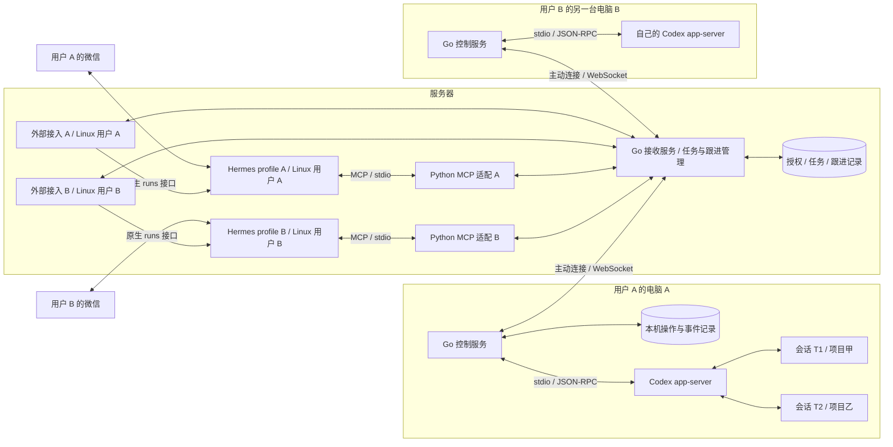
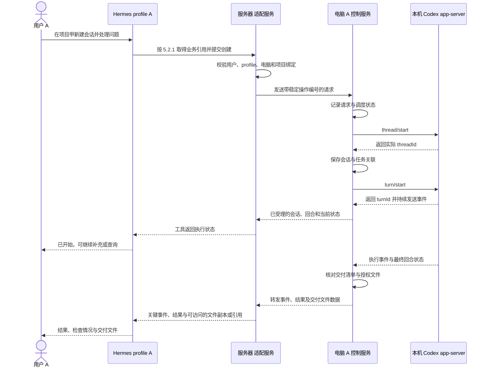
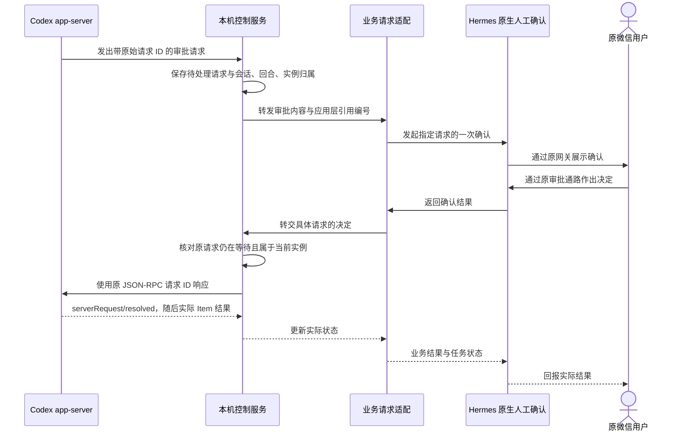
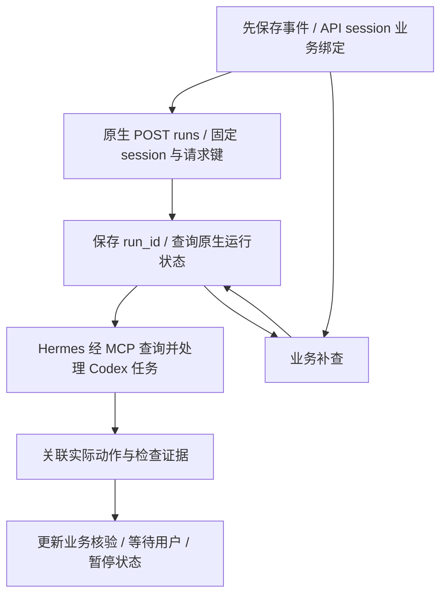

# dots-lite 详细实现方案

日期：2026-10-24。状态：设计文档；项目骨架与依赖已初始化，业务流程尚未实现或部署。

本文依据 [需求](需求.md)说明从微信发出任务到结果交付的实现方式。[README](../README.md)提供项目入口。文中的机器名、profile 名、工具名、接口消息和数据库结构均为设计示例，不是已运行的配置。

本方案复用 Hermes 和 Codex app-server 的现有能力，不修改 Hermes 源码、内部数据库结构或运行循环。我们只实现跨机器授权与传输、业务任务映射、操作去重、暂停意图、结果核验和交付记录；原生能力与证据边界见第 13、16 节。

## 1. 最终要做成什么

你在微信对自己的 Hermes 说：“在电脑 A 的项目甲里新建一个 Codex 会话，处理这个问题。”Hermes 找到你授权的电脑，创建会话并交代任务。任务运行时，你可以继续与 Hermes 聊天，也可以让它查询进展、补充要求、处理问题或停止当前执行。结束后，Hermes 把结果和需要交付的文件发回微信。

服务器 上有多个 Hermes profile，每个 profile 由不同的人使用。不同用户的 Codex 在不同的电脑上运行。一个 profile 可以访问其绑定电脑上的多个已授权 Codex 会话，分别处理不同项目，也可以为同一项目建立不同会话。

第一版以“一个用户对应一个 profile、绑定一台执行电脑”为配置方式，不加入跨用户共享电脑或公共注册功能。首先验证 Windows，其他人的电脑系统和网络条件需要分别核实。

这里的“本机”指各用户实际运行 Codex 的电脑，不是 服务器。云端协调者固定为 Hermes，负责理解目标、选择任务、检查结果和跟进；执行端负责真实执行、确定性查询和状态记录。项目修改和命令执行主要交给 Codex。控制服务另外提供产物自动回传，以及 Hermes 主动查询、读取和下载任务文件的工具，使 Hermes 可以检查与整理实际文件，而非只看到路径。

### 1.1 首版与增强的边界

首版实现需求 R01—R13，具体包括：

- 授权路由：根据可信用户身份和 Hermes profile，将操作送到该用户已授权的电脑。
- 机器就绪查询：分别查询电脑连接、控制服务、Codex 接口和项目是否可用。
- 项目选择：根据已登记的项目别名确定目标电脑上的工作目录。
- 多会话：在同一用户的电脑上创建、查询和继续多个 Codex 会话，并保持各自的历史和操作目标。
- 任务列表：用稳定编号记录任务目标、关联会话、执行状态、等待事项和交付情况，换聊天后仍可查询。
- 追加与停止：向指定的执行回合补充要求或请求中断，并核对要求是否生效或执行是否实际停止。
- 审批与问题：由 Hermes 查证并回答可自行确定的问题，将必须由用户决定的事项和审批关联原请求后交给用户。
- 异步通知：任务在后台运行时仍允许用户聊天，并按原任务归属回报需要决定、持续阻塞、实际停止或最终结果等关键情况。
- 文件获取：自动回传授权产物，或由 Hermes 主动查询、读取和下载指定文件，使其取得实际内容。
- 结果核验：依据实际检查和文件证据，分别确认执行结果、目标是否达成以及文件是否交付。
- 恢复：在断线或服务重启后找回记录并核对实际状态，避免重复执行结果不确定的操作。
- Hermes 集成：薄适配层通过 MCP Server 提供远程执行工具，另接现有 Hermes 后台入口，复用其推理、会话、记忆和 Skills。
- 可靠唤醒和自动异常处理：关键事件发生后可靠触发正确 Hermes profile 的跟进，在原授权和有限预算内诊断、恢复、核验并补查遗漏，必要时交给用户决定。

最小内存原型：只在程序运行期间保存临时状态，用于验证基本链路，不能承诺重启恢复，也不能代替完整首版验收。

需求 E01—E08 是后续增强：完整项目卡片、搜索、日志片段、Git 查询、命令模板、打包与预览、待处理事项汇总和定时简报。先复用 Hermes 已有的会话、后台工作、委派、调度、记忆和 Skills，再补执行端接口，不建设另一套 Agent 平台。

其中 R13 的持续跟进、异常自动处理和遗漏补查是首版必需，不等待用户订阅 E08 简报。Hermes 默认自行查证并处理恢复路径明确、属于原授权的异常，只将无法确定、需要新授权、必须人工介入或达到恢复边界的情况交给用户。

首版不增加任意文件写入或通用 Shell。增强的命令模板也不等于开放任意命令；每个能力独立实现和验收，未实现时明确返回不可用，不静默让模型通过其他路径替代。

## 2. 先确定控制的对象

| 对象 | 例子 | 为什么需要区分 |
| --- | --- | --- |
| 用户 | 用户 A | 决定操作和结果属于谁 |
| Hermes profile | profile A | 确定正在替哪位用户处理请求 |
| 执行机器 | 电脑 A | 决定在哪台电脑运行，不能与其他人的机器混用 |
| 项目 | 电脑 A 上的项目甲 | 决定工作目录和可用项目环境 |
| 任务 | 导出修复任务 Q1 | 稳定记录目标、进展、验证和交付，不依赖当前聊天记忆 |
| Hermes session | 微信中当前选择的主题对话 | 决定交流上下文，不决定任务是否存在，也不自动取消后台工作 |
| Codex 会话 Thread | 会话 T1 | 保存一段持续对话及其历史 |
| 执行回合 Turn | T1 中的回合 R1 | 表示一次用户输入及随后发生的执行过程 |
| 应用操作 | 追加一次要求、停止一个回合 | 需要独立确认和去重，不等于会话或回合 |

例如，用户 A 的 profile A 绑定电脑 A。电脑 A 的控制服务管理会话 T1 和 T2：T1 在项目甲工作，T2 在项目乙工作。你说“继续项目甲刚才的任务”，应当定位 T1；不会因为 T2 最近发过消息，就把要求发给 T2。

首版一项任务关联一个主要 Codex 会话，允许经过多个回合。同一会话的历史与任务的目标、验证、文件交付状态分别管理，不自动从一次回合结束推导整项任务已完成。

官方 app-server 提供会话与回合接口。第一版计划每台电脑由控制服务启动一个受控 app-server，在其中管理多个会话。多会话管理是设计目标；不同会话实际并发、配置生效范围和运行资源需要验证，不能将“可列出多个会话”当作并发测试通过。[官方接口](https://learn.chatgpt.com/docs/app-server#api-overview)

会话、回合、Item、历史和实时状态以 app-server 为准。通过 `thread/list`、`thread/read`、`thread/loaded/list`、`thread/turns/list`、`thread/items/list` 和 `thread/status/changed` 查询或更新，不另建 Codex 会话存储或执行状态引擎。Go 只保存业务绑定、投递所需摘要与观察时间。

用户明确要求持续推进的线程，优先采用 `thread/goal/set/get/clear` 的原生 Goal：目标、状态、预算和线程内续跑由 Codex 管理。Hermes 监督异常、跨任务协调、核验与交付，不在每次普通回合结束后再自行启动下一回合。原生 Goal 与 Hermes 不能同时争用同一线程的续跑权；目标暂停、变更和原生能力不足的处理见第 6.3、10.8 节。[原生 Goal](https://learn.chatgpt.com/docs/app-server#manage-a-thread-goal)

独立启动的多个 Codex 进程可能属于不同运行实例。控制服务连接到自己的 app-server，不代表它可以操作其他进程的活跃会话。原生桌面端已有聊天的接入要单独验证，本文不将其视为已经具备的能力。

## 3. 程序分别放在哪里



图中的两个 Python MCP 适配及各自的后台唤醒接入分别运行在对应 Linux 用户下，不共用进程身份。MCP 工具调用与后台事件处理是两条通路，后台入口不依赖一次活跃工具调用。公共 Go 接收程序使用独立的无特权服务账户，必须按用户、profile 和机器区分连接与数据。它不能把所有人的会话汇总为一个所有 profile 都能读取的列表，也不能获得 root 或切换用户执行的权限。

### 3.1 服务器 上的程序

保留现有微信接入和各 Hermes profile，Hermes 不再作为可替换的云端 Agent 候选。增加工具适配、连接接收、任务查询、关键事件待处理记录、跟进处理、通知与周期补查。

Hermes 的工具入口采用 Python MCP Server，保持为薄适配层。首版各 profile 通过自己的 Hermes 配置启动本地 stdio MCP 进程，进程使用该 profile 的 Linux UID 和私有环境，不增加共享的远程 HTTP MCP 入口。新增的远端常驻服务使用 Go，集中承担连接接收、授权路由、任务状态、持久记录、可靠跟进与通知。首版不将这些 Go 职责拆成多个网络服务。

Python 适配向 Go 服务提交业务操作；后台接入使用 Hermes 原生 `POST /v1/runs`，以持久保存的 `Idempotency-Key` 提交同一事件，保存返回的 `run_id` 并通过原生状态、事件、steer 和 stop 接口核对处理。不自建 Hermes run 登记、通用 worker 调度、运行状态机或停止协议。Go 保存业务事件与原生 run 的关联，不复制 Hermes 的完整运行记录。

工具调用与后台接入可以共用适配包，但生命周期分开。各 profile 的外部接入以本用户身份领取 Go 中属于自己的事件，调用本 profile 已有 API；集中 Go 服务不读取 profile API 凭据或切换用户执行。按官方现有配置启用、认证和限制 API，只连接已登记端点。接入不要求修改 Hermes 核心。原生接口是否启用、持久化是否生效和通知能否回原微信聊天，仍需端到端验证。

Hermes 已负责 MCP 发现、连接恢复及不确定写调用的防重放，不额外实现一套 MCP 重连器。我们保留业务操作查询与跨机器去重；MCP 返回不确定后，不换编号盲目重做。原生 Kanban 已有持久队列和 worker 管理，首版不同时叠加使用；有明确需求时再复用每个用户自己的任务板，不建设通用 Agent 调度器。

不能把 profile 作为一个由模型自由填写的参数，再无条件相信它。调用归属应由工具运行环境及实际消息来源提供。

可信聊天来源采用 Hermes 官方插件扩展，不以 stdio MCP 自动传入上下文为前提。`pre_tool_call` 每次先检查无环境回退的原生上下文，再经现有 Unix socket 向 Go 登记本次来源与参数，向 MCP 注入 Go 返回的调用引用。Go 读取自己的登记，不因来源字段齐全就信任模型参数。它是薄适配的一部分，不修改 Hermes 核心；具体契约见第 8.1 节。

机器在线与 Codex 就绪、项目列表和任务快照由程序直接查询，不必为这些操作启动 Codex 模型回合。Hermes 的长期记忆保存稳定偏好，Skills 保存重复方法；任务状态来自持久记录和执行端，不写成一段记忆后就视为事实。

### 3.2 每台用户电脑上的程序

各电脑运行自己的 Go 控制服务，编译为对应系统与架构的可执行文件；当前先验证 Windows。它使用该用户的 Codex 登录、配置与项目，通过子进程启动 app-server，并持续读取其输出。控制服务本身不要求用户额外配置 Node.js 或 Python 运行环境；Codex 与项目工具仍是各自独立的前置依赖。

各电脑保存自己的状态和连接凭据。电脑 A 不需要访问电脑 B 的文件、数据库或 app-server。公共程序可以相同，用户数据不能一起复制。

控制服务分别报告连接、app-server 初始化、项目可用和回合状态。连接在线但 Codex 未就绪时，查询仍可返回诊断事实，有副作用的执行请求不能被误报为已启动。

Codex 登录、令牌刷新、模型能力与沙箱沿用其原生管理。必要时调用 `account/read`、`model/list` 等查询，不自建 OAuth 或权限执行引擎；账户存在、模型可列出仍不能替代一次真实执行验收。我们自己的机器认证、项目范围与路径授权继续独立检查。

电脑必须开机、网络可用，且控制服务与 app-server 正常运行。正式使用时再安排后台运行方式；重启进程与恢复原任务是两件事。

### 3.3 各条连接的边界

| 连接 | 谁发起 | 传什么 | 使用方式 |
| --- | --- | --- | --- |
| 微信与 Hermes | 沿用现有接入 | 消息、问题、回复与附件 | 核对现有 Hermes 实现后复用 |
| Hermes 与本 profile 的 MCP Server | Hermes 启动本用户的 MCP 子进程 | 工具发现、调用与结果 | 本地 MCP / stdio，不跨用户共用进程 |
| Python 适配与集中 Go 服务 | 各 profile 的 MCP 进程或常驻后台接入 | 操作、查询、待处理事件与处理确认 | Unix domain socket，按内核对端 UID 认证 |
| 外部接入与本 profile 的 Hermes API | 本用户后台接入 | 原生 run 创建、状态、事件、追加与停止 | 已有认证 HTTP 接口，凭据留在本用户私有环境 |
| 用户电脑与 服务器 | 各电脑控制服务主动连接 | Codex 操作、状态、事件与附件数据 | 优先使用 Tailscale 上的 WebSocket，分别认证 |
| 控制服务与 app-server | 同一电脑上的父子进程 | JSON-RPC 调用、响应、通知和服务端请求 | stdio，不开放 app-server 远程端口 |

跨机器 WebSocket 与 app-server 支持的 WebSocket 传输不是同一条连接。本文选择自己实现前者，并在本机使用 stdio 接入后者。

### 3.4 技术栈与代码分工

| 模块 | 语言与部署 | 职责 |
| --- | --- | --- |
| Hermes MCP 工具与后台接入 | Python，服务器 上各 profile 独立运行 | stdio MCP 提供业务工具；官方 pre_tool_call 插件注入可信来源，复用 elicitation、原生 runs 和现有渠道发送，不复制运行登记、重连或 Agent 循环 |
| 远端接收与跟进服务 | Go，服务器 | WebSocket、机器认证、授权路由、任务与操作记录、跟进确认、补查、预算、交付状态 |
| 执行端控制服务 | Go，各用户电脑 | 管理连接和子进程；调用原生会话、Goal、审批、文件与命令接口；保留授权、业务操作记录和跨机器回传 |
| 文档和数据处理 | 优先复用 Hermes 的 Python 工具与 Skills | 检查已取得的产物、整理文本和生成预览；必要的本机固定操作按需求另接入 |

远端服务与执行端共用一套 Go 协议定义和必要的基础代码，通过带版本的消息结构通信。Python 适配边界按相同协议校验；类型定义不能代替运行时的身份、归属和消息校验。

Python 与本机 Go 远端服务通过 Unix domain socket 提交、查询和回传处理结果，由 Go 服务读取内核提供的对端 UID，并按管理员维护的 UID/profile 映射认证；请求中的 profile 名称不能覆盖该身份。Hermes 侧调用已核查存在的原生 runs 和确认入口，部署配置与具体 schema 另行验收，不发明后台回调协议。两种语言只传业务数据，不共享数据库写入逻辑；业务任务、累计预算和去重集中由 Go 管理。

Go 侧使用标准库的 `os/exec`、`context` 和 JSON 管理 app-server 子进程与连接；文件内容访问优先复用 `fs/*`，已授权命令复用 `command/exec`，不再自建同功能的文件后端或命令运行器。跨机器文件传输、私有暂存和实际路径授权仍自行实现。WebSocket 与 SQLite 依赖实现前核对版本和目标系统，不将单文件分发当作无依赖承诺。

进程停止先走 Codex 回合中断，控制服务退出和异常清理另外处理。Go 的 context 取消不是整个 Windows 进程树自动清理的保证，必须实测子进程生命周期、stdout/stderr 排空和孤立进程恢复。发布时验证目标架构，并跟随 Go 及依赖安全更新重新构建与分发，不将选择 Go 等同于没有漏洞。

### 3.5 Go 开发环境与构建

Go 环境不使用 mise，也不额外引入专用版本管理器。开发和构建机器安装官方稳定版 Go，按官方安全更新维护；项目通过 `go.mod` 的 `go` 与必要的 `toolchain` 声明版本要求，使用 Go 内置工具链选择机制。默认保留 `GOTOOLCHAIN=auto`，不统一设置为 `local`。[官方工具链说明](https://go.dev/doc/toolchain)

`go` 行表示最低要求，`toolchain` 行表示建议工具链，不能将它们解释为精确锁定所有构建版本。正式发布时明确选定实际工具链，记录 `go version` 与构建目标，避免未经核对地使用不同版本产出发布文件。

依赖使用 Go Modules，由 `go.mod` 与 `go.sum` 管理版本要求和校验信息。格式化、检查、测试与构建直接使用 `go fmt`、`go vet`、`go test` 和 `go build`，首版不强制额外任务运行器。需要多平台打包发布时再评估 GoReleaser，不作为最小验证的前置条件。

执行端用户运行对应平台的已编译控制服务，不需要为控制服务安装 Go 工具链。Codex、项目工具和实际依赖仍按各机器独立准备。当前已建立 Go 模块、两个服务占位入口、预选依赖和 Python 适配环境，具体开发命令见 README；尚未实现服务功能。本次初始化未修改全局环境或卸载现有 mise。

## 4. 首次接入一台电脑

这一步发生在日常发任务之前，需要人工确认实际用户与机器归属，不让模型自行配对。

1. 核对微信账号、发送者、聊天和实际处理它的 Hermes profile，确认它们属于用户 A。
2. 确认电脑 A 是该用户授权的机器，核对其系统、Codex 版本、登录与配置。
3. 在电脑 A 登记允许使用的项目别名，例如 `project-alpha` 对应本机项目甲的实际目录，附必要说明和授权范围。Hermes 传项目别名，不猜目录，也不需要知道其他电脑的路径。测试、启动与构建命令属于后续完整项目卡片，不因登记文字而自动运行。
4. 为电脑 A 分配单独的连接凭据。在 服务器 保存其与用户 A、profile A 的授权绑定；凭据不放进公共配置、聊天或项目文档。
5. 控制服务连接 服务器。接收端根据凭据识别机器，不能仅凭消息里自报的机器 ID 认领连接。
6. 控制服务启动本机 app-server，完成 `initialize` 请求和 `initialized` 通知，再报告服务可用。
7. 服务器 区分“电脑连接在线”和“Codex 接口已就绪”。只有前者成立时，不得声称已经可以执行任务。

app-server 的初始化顺序以官方文档为准。实现时根据实际安装版本生成或核对 schema，不直接照搬其他版本示例。[初始化与生命周期](https://learn.chatgpt.com/docs/app-server#initialization)

Tailscale 只提供设备通信路径。每台机器仍需独立的应用认证。其他用户是否已经加入合适的网络尚未核实；无法接入时应明确报告，不临时将原始 app-server 暴露到公网。

## 5. 从微信提交一个新任务

假设你发送：“在项目甲新建一个会话，修复导出失败的问题，先复现，再修改并检查。”



### 5.1 Hermes 先确定操作目标

本项目插件通过第 8.1 节的原生上下文和执行前钩子传递真实来源，Go 再结合对端 UID 与授权绑定选择电脑 A，把“项目甲”解析为已登记项目别名。来源字段不是模型识别或填写的用户身份。

如果“继续刚才那个”能从当前聊天绑定中唯一确定目标，就直接使用。若当前聊天涉及多个会话，且上下文不能确定目标，才向用户询问选择。不能通过“最近收到哪个会话事件”决定当前会话，因为后台任务可能同时运行。

### 5.2 服务器 登记一次逻辑操作

Go 服务在现有业务操作表中登记稳定操作编号，例如 `op-demo-001`，记录用户、profile、聊天、目标、任务版本和确定的参数。同一操作的传输重试沿用这个编号；同号不同参数拒绝。新建任务时，任务编号 Q1、操作编号和参数在同一事务中保存，再允许调度；查询或继续已有任务复用 Q1。

微信接入若提供稳定的消息 ID，可与可信来源一起用于识别重复投递。若现有接入没有可用的稳定标识，需要先记录这一限制，不能用“文本相同”判定重复，因为用户可能真的要求再做一次。

### 5.2.1 首次响应丢失时如何找回操作

必须在第一次有副作用的提交之前，让调用方持有一个可恢复的业务引用。复用已有业务操作表和任务查询接口，不增加第二份适配侧账本，也不让模型负责生成可信身份或幂等保证。

| 调用条件 | 提交方式 | 响应丢失后的恢复 |
| --- | --- | --- |
| 已有已登记的业务操作编号，或外部接入已持久保存并能恢复的请求键 | 单次提交；Go 原子建立或读取请求键到操作的映射，提交前已落库 | 按原编号/键查询或重试；同键不同参数拒绝 |
| 普通 MCP 调用没有可恢复的业务引用 | 先登记操作，再提交该编号；登记只保存计划，不调用 Codex、不发文件、不发送消息 | 登记响应丢失可重做登记，最多留下未提交记录；提交响应丢失时，编号已在前一次工具结果中可见，先查询该编号 |

第二种路径只用于缺少稳定引用的有副作用操作，不给只读查询、Hermes runs 或已有编号的重试增加额外阶段。登记不是审批，也不要求用户再确认。工具可在同一入口提供登记与提交两种动作；调用方只能提交已登记且归属正确的编号，不能通过“没有编号就新建并立即执行”绕过前置引用。MCP 协议请求 ID、时间戳、相同文本或模型临时填写的键，都不能自动升级为第一种路径的恢复依据。

登记返回 `task_id`、`operation_id`、目标、参数摘要和 `prepared` 状态；提交引用 `operation_id`，服务读取已保存参数，不接受替换参数。提交前再次校验权限、任务版本、暂停状态和原请求有效性；已失效的登记不能执行。同一操作的并发提交在 Go 与执行端都只沿用原操作记录，不再次调度已提交或结果未知的动作。Codex 回执丢失仍按第 10.2 节核对，登记本身不消除其提交窗口。

换 session 或 MCP 重启后，已有任务查询可按本用户授权范围列出操作，返回编号、目标、摘要、创建时间、处理阶段及观察时间。列表包含已登记、处理中、未知和最近终态记录，不能只列“未结束”，否则快速完成但响应丢失的操作会被漏掉。终态摘要在确认恢复前保留；精确查旧编号时，记录已归档、不可得与不存在分别报告，不重新执行。

没有编号时先查这个列表，不按相同文本自动重用或自动重新执行。能查明的结果由 Hermes 自行核对；多个候选无法区分、记录不可得或副作用仍未知时保留未知并升级。同一目标已有结果未知且可能冲突的操作时，新编号不能绕过核对；只有原操作已查明，或用户明确知道风险并另行授权新的操作，才处理为新要求。该限制不阻塞只读诊断和停止；用户停止按已有任务编号与新暂停版本处理，不等待登记或未知动作核实。取消、失效或未提交登记不产生执行副作用，不为清理登记而运行任何任务。

### 5.3 电脑 A 接收并调用 Codex

本机服务先验证请求属于当前绑定，再按操作编号查重。正式版本先持久记录，再调度 app-server。若已处理过同一请求，就返回已记录状态；不能再次创建会话。

新建会话使用 `thread/start`，保存实际返回的 `threadId`。开始执行使用 `turn/start`，保存实际返回的 `turnId`。工作目录、模型和权限配置按项目绑定及实际 schema 传入，不使用另一个用户或机器的设置。

创建会话与启动回合是两个步骤。前者成功、后者失败时，应回报“会话已创建，启动失败”，保留可继续使用的会话记录。不能将整个请求简单标成成功或再创建一份会话。

### 5.4 工具尽快返回，事件持续处理

Hermes 工具只在有限时间内等待请求受理和启动结果，不占着一次调用等待几小时直到任务结束。超时后返回已知阶段与操作编号，无法确认时明确标记未知；后续通过查询核对，不能自动重发。常驻服务继续读取事件，因此用户仍能与 Hermes 交谈或切换到其他任务。

普通进度可以按时间或内容变化合并。等待输入、失败、停止和最终结果进入持久跟进记录；程序先更新实际状态，必要时唤醒 Hermes 查证并恢复。可自动解决的问题不逐条询问用户；需要新决策、持续阻塞、重要影响、实际停止和最终结果再通知用户。每个文字片段都重新唤醒 Hermes，会增加成本并造成微信消息拥挤；不把这作为默认方案。

所有通知带任务编号或可读名称，按原任务归属回传。用户换 session 不改变通知目的地。后台通过本 profile 原生 runs 接入，以任务目标、约束和证据构造必要上下文，不依赖最近聊天，也不自行启动第二个普通 Hermes 常驻进程共写 profile。会话续接、忙碌协调与回原聊天的实际行为通过接入测试核对；不可用时保留业务待办，不选择其他用户或任意 session。

### 5.5 区分执行结束与任务完成

`turn/completed` 表示回合结束，需要检查其状态。状态为失败或被中断时，不能回报成功；正常结束也不自动证明用户目标达成。

最终报告应包含 Codex 实际完成的工作、运行的检查、结果与未完成事项。如果验证证据不足，就说清楚。Hermes 可以在用户已授权的任务范围内发送后续指示，让 Codex 补齐检查；不能自动扩大到发布、推送或其他未授权操作。

检查失败或缺少证据不默认立即转交用户。Hermes 先读取错误、必要日志与产物，选择原目标内明确的修复或补查动作，提交给 Codex，再核对下一次结果。只有必要信息仍缺失、目标或权限不明确、必须人工操作、状态风险无法消除或恢复预算耗尽时，才停止自动推进并向用户提出具体问题。

任务记录分别保存执行结果、验证结论和交付状态。验证信息至少包含检查内容、实际结果和证据引用；没有有效检查时保留待核验，不能生成一条虚构的“已通过”。

## 6. 一个 profile 如何管理多个 Codex 会话

profile A 绑定电脑 A，但不只绑定一个会话。电脑 A 内部可以有如下记录：

| 便于识别的名称 | 项目 | 实际 Codex 会话 | 当前状态 |
| --- | --- | --- | --- |
| 项目甲导出修复 | project-alpha | T1 | 正在执行回合 R1 |
| 项目乙测试整理 | project-beta | T2 | 空闲，可继续 |
| 项目甲方案讨论 | project-alpha | T3 | 等待用户回答 |

这些编号都是示例。显示名称用于选择，真正调用使用实际标识及其机器归属。会话列表只查询该用户授权机器上的可访问会话，再检查项目范围。

### 6.1 继续一个空闲会话

用户说：“继续项目乙的测试整理，加上异常输入的情况。”服务定位 T2，检查它没有活跃回合。会话尚未加载时，先 `thread/resume`；然后 `turn/start`，把新要求作为该会话的新回合。

恢复历史仅用于允许恢复的会话。若发现它属于其他活跃进程或无法核实所有者，应返回冲突或状态未知，不新建竞争进程继续写入同一会话。

### 6.2 给执行中的会话追加要求

用户说：“给项目甲正在修的任务补一句，保留现有接口。”服务定位 T1 及其当前回合 R1，用 `turn/steer` 发送要求。官方接口要求 `expectedTurnId` 与当前活跃回合相符。[执行中引导](https://learn.chatgpt.com/docs/app-server)

如果 R1 已经结束，原 `turn/steer` 返回过期结果，不能谎称追加已生效，也不能将同一操作直接改投其他回合。先查询当前回合与 Goal；由原生 Goal 管理的普通续跑不再由 Hermes 重复启动。确需提交新的用户要求或已授权修复时，先核对当前空闲状态及业务版本，再用新操作编号提交；不能把过期 steer 自动重放成新回合。无法明确判断时才询问用户。

### 6.3 停止一个会话的当前执行

用户说：“停掉项目甲的导出修复。”服务定位 T1/R1，调用 `turn/interrupt`。先报告“停止请求已提交”，再根据实际终止事件更新为“已停止”。

停止整项任务时，先持久保存业务暂停与新状态版本，使旧版本排队动作失效；执行端同样在提交前检查。若有原生 Goal，先请求将其置为 `paused`，再调用 `turn/interrupt`；只中断回合不能替代整项任务暂停。接入方按实际用户决定设置 Goal 变更来源，不允许模型自报用户授权。无法连接时保留暂停意图，重连先落实暂停再恢复调度。用户明确继续后才解除暂停，并先核对原回合状态。

断线期间无法向执行电脑落实暂停时，明确回报“暂停后续提交，远端停止尚未确认”；不声称原生 Goal 已暂停或 Codex 已停止。连接恢复后先同步暂停版本、查询 Goal/当前回合，再落实原生暂停与中断。此阶段不提交新的执行或恢复动作，直到取得可核对结果。

停止保留会话历史，后续可以继续。它不会自动撤销已经修改的文件或已发生的外部操作，也不会停止 T2、T3 或其他用户电脑上的任务。

### 6.4 多个会话不能共享错误的当前目标

当前聊天选择、后台会话执行状态和正在等待的审批分别保存。切换当前会话，不应改写其他会话的通知目的地。

同一会话的启动、追加和停止需要按状态协调，避免重复启动回合。状态协调只覆盖短时调度，不在整个执行期间持有一个阻塞所有操作的锁；查询、追加、停止和审批响应必须能在执行中送达。

不同会话可以独立调度，但修改同一目录时仍可能冲突。Codex 官方提供 worktree 隔离建议，Hermes Kanban 也已有依赖与并发限制；这些不等于原生 Goal 会自动串行本项目的独立线程。首版保持不自动创建 worktree、不叠加 Kanban 调度的既定方式，只在执行端已有任务记录中保存目录的当前写任务，不建设通用锁或新的调度平台。

目录占用以同一机器上解析后的实际目录为准，项目别名相同、不同别名指向同一路径或目录范围重叠时均按冲突处理。可能写入的任务从开始执行起持有占用，贯穿整个 active Goal；某个回合结束、线程暂时 idle、等待审批或网络断开都不释放。后续原生自动回合仍属于该任务，无需经过一套新续跑调度。

交给另一写任务前，先通过原生接口确认旧 Goal 已暂停、结束或清除，且实际回合与本任务已知写入动作均已静止；不使用 Goal 的单一状态代替全部核对。不能确认时保留占用，重启后按原绑定重新核对。此占用只阻止其他冲突写任务，不持有阻塞查询、停止或审批响应的全局锁，也不宣称能约束本系统之外的编辑器或进程。

### 6.5 任务列表与 Hermes 会话切换

服务器 保存任务索引，提供列表和详情查询。首版不建设独立网页看板，微信中的文本列表和 Hermes 工具返回结果即可。每项任务至少包含：稳定编号、名称、目标、用户/profile/来源、机器、项目、主要 `threadId`、当前 `turnId`、执行状态、等待事项、验证结论、产物与交付状态，以及状态观察时间。

列表只返回当前授权范围内的数据。离线时可显示最后已知状态，但必须标注时间与无法刷新，不能把旧快照说成实时结果。选择任务后，服务使用任务绑定查找会话；不依据模型记住的文件路径或裸 ID 直接执行。

Hermes `/new` 或切换 session 后，新的对话可查询和选择原任务；用户明确继续时再把该任务摘要作为必要上下文提供。机器授权、任务归属和文件权限不随聊天切换而变化，也不自动把以前的 Codex 回合停止或重启。

暂停 Hermes 主对话、停止一个 Codex 回合和取消一个定时计划分别处理。后续命令模板任务也使用自己的运行编号；不能用一个全局“停止”操作同时终止所有用户和所有任务。

## 7. 审批和用户问题如何来回传递

Codex 原生负责产生请求、等待答复、继续执行和清除请求。我们只适配原始 schema、绑定业务归属并转发，不另建审批执行引擎。必须由用户决定的审批使用实际配置中的用户审查通路，不将 `approvalsReviewer=auto_review` 当成人工决定。[官方审批说明](https://learn.chatgpt.com/docs/app-server#approvals)

简单的一次批准或拒绝优先复用 Hermes MCP elicitation 和网关已有 `/approve`、`/deny` 处理，不自建微信身份识别、批准凭据或审批网页。后台 run 发现需用户决定时，先保存业务待办并通知原聊天，再由可交互会话处理；不能假定后台 API 审批自动转入原微信会话。

后台待办只保存原 Codex 请求的引用，不先在无人应答的 run 中开启 elicitation。原聊天通知给出任务和待办引用，用户进入处理时，MCP 工具先查询该请求及实例是否仍有效，再展示保存的原始动作并发起原生确认；结果只映射回这一个引用。请求已失效、任务已暂停或版本变化时，返回当前事实并关闭旧提示，不提交批准。该接入只连接已有待办查询和人工确认，不另造审批收件箱或用户认证系统。



命令、文件、网络与权限请求保留原始类型、内容和 `availableDecisions`；一次同意不能扩成 `acceptForSession`、策略修改或更大权限。安装版 Hermes elicitation 接受后返回空 `content`，适合单次确认，不是完整表单。权限子集、结构化用户问题、多选或 MCP 表单/URL 请求，须按 Codex 原始 schema 明确适配；当前通路无法表达时保持等待并报告，不压成布尔值或用空答案冒充拒绝。

已有资料可回答的问题由 Hermes 查证后回应，用户偏好和新授权才询问。首版同一微信会话只展示一个待确认项，其余请求在业务层排队并保留各自引用；两个请求仍可分别批准和拒绝，不使用 `/approve all` 扩大范围。服务器 源码中的相同文本五分钟去重可能影响连续确认，须实际验证，不能因此修改 Hermes 核心或静默换审批渠道。

轻量转发记录只保存机器/连接实例、任务、profile、原 request ID、thread/turn/item、原始内容及转发结果。`serverRequest/resolved` 只表示已回答或清除，不证明批准或执行成功；还要读取 `item/completed` 和回合结果。源请求失效就撤销本地提示。官方文档未提供待审批请求跨重连持久重放保证，不能用旧数据库记录重建原请求或继续回答旧 ID。验证须真实触发批准、拒绝、过期和多请求排队。

## 8. 两端之间的消息需要包含什么

下面是我们自建 WebSocket 通道的示意结构，不是官方 app-server 的接口。最终工具名和字段在实现时确定。

```json
{
  "type": "operation",
  "operation_id": "op-demo-001",
  "task_id": "Q1",
  "executor_id": "machine-a",
  "action": "turn.steer",
  "folder_id": "folder-alpha",
  "thread_id": "T1",
  "expected_turn_id": "R1",
  "input": "保留现有接口"
}
```

用户与 profile 的可信归属由认证连接和远端授权记录提供。消息中的机器、项目和会话字段只是待验证目标，不能自己授予权限。

操作回复至少区分：已记录、已提交 Codex、Codex 已受理、明确失败、结果未知。执行结果另外通过事件更新。对于查询等没有副作用的操作，可以直接返回快照；有副作用的操作必须保留处理阶段。

应用操作 ID、app-server 客户端调用 ID、app-server 发起的审批请求 ID 和 `threadId`/`turnId` 是不同标识。控制服务维护对应关系，不能把一个编号到处复用。

业务恢复按第 5.2.1 节：已有可恢复键时单次提交，普通 MCP 缺少该依据时先做无副作用登记，再引用编号提交；不重复实现 Hermes runs 的原生幂等。MCP 调用 ID 和 Codex JSON-RPC ID 不视为跨重启幂等键。本机 schema 虽有 `clientUserMessageId`，但官方文档未建立其对 `turn/start` 的持久去重保证，不能据此删去跨机器操作记录。

事件记录还要包含原归属、机器、会话、回合、类别、发生时间和本地序号。序号用于我们自己保存的事件记录，不声称是 Codex 提供的永久回放游标。

首版开放约定的 Codex 操作、附件传输和授权任务文件获取接口，不把任意 app-server 方法原样透传给 Hermes。文件查询与下载是我们补充的控制服务能力，不是假定 app-server 会把文件自动上传给 Hermes。已连接该机器不代表所有接口或本机文件都属于本项目授权范围。

### 8.1 提供给 Hermes 的首版能力

以下能力通过 MCP tools 提供，不预先固定工具数量和具体名字。用户与 profile 归属由 MCP 进程的实际 UID 与服务端映射确定；聊天来源通过 Hermes 官方扩展接入，而不是让模型自报或从长驻 MCP 进程的启动环境推断。

本项目的 `pre_tool_call` 插件只匹配本项目 MCP 工具，通过官方插件注册和启用，不用失败开放的观察钩子代替执行前处理。处理顺序如下：

1. 先调用官方 `gateway.session_context.bound_session_key()`，要求当前任务确有非空绑定。该函数只读当前 ContextVar，不回退 `os.environ`；不能用进程级 `session_context_engaged()` 代替逐次判断。绑定为空就拒绝，不继续从 `get_session_env()` 取可能来自旧环境的身份。
2. 在原生网关/API 已全量绑定会话变量的执行路径中，读取平台、聊天、用户、线程、会话及可用消息 ID，并取得本次钩子的原生 session/task、tool-call 标识。检查必要字段及当前执行类型；来源仍不完整或上下文不一致就拒绝。裸 CLI、未绑定钩子任务、共享进程环境和全局“最近聊天”不能代替这些值。安装版缺少所需原生绑定入口时明确阻止接入，不修改核心补入口。
3. 丢弃模型提交的来源与内部引用字段，以稳定的结构化表示计算本次业务参数摘要，经现有 UID 认证 Unix socket 向 Go 登记真实上下文、完整工具名和摘要。后台调用还须通过下述预登记 session 绑定。登记不是执行或审批，不调用 Codex。
4. Go 返回短期、不可猜测的 `_context_ref`，插件覆盖工具的内部引用参数。MCP 输入允许这个保留字段，但不要求模型生成；登记接口不作为模型可调用 MCP 工具开放。普通来源字段最多用于诊断，不作为认证依据。
5. MCP 向 Go 转交 `_context_ref` 和业务参数。Go 核对已登记记录的 UID/profile、工具名、精确参数摘要、有效期和适用任务/版本，再使用登记中的来源处理。没有登记、引用已过期、工具或参数被修改时拒绝；来源字段再完整也不能放行。因此插件未启用、匹配漏项或根本没有运行时，裸模型调用同样不能通过。

调用引用只在现有 hub 中短期保存，不增加独立数据库、密钥体系或身份提供方，也不替代 Hermes 原生认证。引用只适用于本次确定调用；重复投递只关联原处理或原业务操作，不再产生第二次副作用。hub 重启导致引用失效时，插件重新取本次上下文登记，业务提交仍按第 5.2.1 节的原编号恢复，不能因重签引用而重建操作。引用在 MCP 开始处理时校验；人工确认结束后仍需重新核对任务、版本和原审批有效性。

这沿用 Hermes 插件与本用户进程受信任的模型，防止模型字段、漏装钩子或错误路由被当作可信来源；不声称隔离同一 Linux UID 下任意恶意代码。跨用户边界仍由 UID、私有文件权限和 Go 逐项授权保持。消息 ID 缺失时，来源齐备也不能跳过首次提交登记。

后台 API 调用使用第 10.5 节在 POST 前保存的独立原生 session 绑定。钩子从当前 API 上下文取得 session/task 标识和执行类型，再由 Go 查其已登记的任务、事件及版本；不从模型参数选择业务任务或填写 run_id。工具参数的目标或版本与绑定不符时拒绝，不能凭同 profile 改投另一任务。通知使用业务任务原聊天，不把 API session/chat_id 当作微信聊天。无关联时仅允许本用户范围内的只读诊断，禁止业务变更和外发；这类诊断同样必须有有效调用引用。

当前官方文档和实现已提供上下文、改参及无环境回退的绑定读取入口，但调用引用是本项目为独立 MCP 进程补的薄传递契约，不是 Hermes 原生的来源签名功能。`bound_session_key()` 非空只证明当前 key 已绑定，不能单独证明所有来源字段齐全；只接受已核对会全量绑定来源的网关/API 工具执行路径。服务器安装版的字段与行为仍需实际核对。不能将缺少 stdio 自动传递说成 Hermes 没有办法，也不将上游能力宣称为 服务器 已启用。[官方钩子](https://hermes-agent.nousresearch.com/docs/user-guide/features/hooks#pre_tool_call)、[插件与调用上下文](https://hermes-agent.nousresearch.com/docs/developer-guide/plugins)、[无环境回退的绑定实现](https://github.com/NousResearch/hermes-agent/blob/14e1e43a23761b369641208e204365cd6cb9399d/gateway/session_context.py)

| 能力 | 主要输入 | 返回结果与执行位置 |
| --- | --- | --- |
| 机器与 Codex 状态 | 已授权机器或默认绑定 | 连接、接口就绪、观察时间及错误；由程序查询 |
| 项目列表与基本信息 | 机器、项目别名 | 已登记目录、说明、可用状态；不运行项目命令 |
| 任务列表与详情 | 可选状态筛选、任务编号 | 执行、等待、验证、产物和交付情况 |
| 会话查询与任务创建/继续 | 项目、会话或任务、要求；有副作用提交按第 5.2.1 节引用已登记操作或可恢复键 | 任务/操作编号、登记或实际受理阶段、真实会话/回合，不以登记冒充启动 |
| 执行中追加与停止 | 任务、目标回合、要求或动作 | 精确目标的处理结果，不自动改成新回合 |
| 审批与问题响应 | 任务、有效请求及原始 schema；问题答案或发起人工确认 | 可查明问题由 Hermes 回答；人工决定走原生确认通路，不接受模型自填批准标志 |
| 文件查询与获取 | 任务、授权相对路径、必要内容范围 | 清单、目录、文本或实际下载文件引用 |
| 跟进诊断与处理确认 | 任务、跟进记录、当前证据、处理动作和结果 | 查询必要错误、操作阶段与日志片段，记录决定、后续操作及验证或升级结果 |

首版就能回答“现在有哪些任务”和“这项任务等我做什么”，并自动跟进可处理异常。R13 需要的错误详情与有限日志片段属于首版诊断能力；E02/E03 的通用搜索与日志便利查询仍是增强。跨任务的待处理事项聚合和用户订阅的定时摘要是 E07/E08，不以完整看板作为首版前置条件。

查询工具直接返回有界快照。缺少可恢复引用时，登记工具先返回 `task_id`、`operation_id` 和未执行状态；实际提交及时返回原编号及真实受理阶段，不等待整个回合结束。调用超时或 MCP 进程退出后按第 5.2.1 节查询原操作，包含最近终态，不盲目创建新操作。MCP 请求 ID 只用于本次协议调用，不替代业务引用。

文件工具须让 Hermes 在对应 profile 的私有目录取得实际文件，或得到经验证可读取的附件引用；返回执行端路径或 MCP 资源 URI 本身不算文件获取成功。首版采用普通 MCP 工具受理与查询，后台处理直接复用 Hermes runs，不依赖新版 MCP 事件订阅或异步任务扩展。

## 9. 为什么保存状态，SQLite 到底放什么

持久化用于在重启或断线后找回归属和处理结果。它不负责运行 Codex，也不替代 Codex 保存的原生对话历史。

### 9.1 最小验证版先用内存

最初只验证同一进程存活期间的完整链路：一个用户、一台电脑、一个会话，提交任务并收到实际结果。授权映射和临时任务状态可以先放内存，用明确的本地配置限定允许的用户和机器。

这一版不能承诺服务重启后继续跟踪、恢复未决请求或安全重试。停止测试服务后，必须报告原任务需核对；不能丢掉记录后又把旧消息当作新任务执行。它是验证程序，不是正式可用版本。

### 9.2 正式版本使用 SQLite

| 位置 | 保存内容 | 主要解决的问题 |
| --- | --- | --- |
| 服务器 的业务库 | 用户/profile/机器授权，项目引用，稳定任务与验证/交付摘要，聊天绑定，业务操作和暂停版本，待投递事件及 Hermes 请求键/run 引用，累计恢复预算和通知结果 | 找回跨机器业务关系，不复制 Hermes run 的内部状态机 |
| 每台用户电脑的业务库 | 项目映射、任务到原生 thread/turn 的绑定、操作阶段与回执、临时审批转发引用、关键事件及传输进度 | 避免跨机器重复提交；审批是否仍有效以当前实例为准 |
| 各 profile 的 Hermes 私有状态 | 原生 session、run、幂等登记、配置、记忆、cron，以及选用时的私有 Kanban | 全部由 Hermes 管理，通过已有接口查询，不直接改内部库 |
| Codex 自己的数据目录 | Codex 原生会话历史和相关运行数据 | 由 Codex 管理，我们通过接口读取必要内容 |

SQLite 是当前选择，不是唯一可行工具。它无需单独的数据库服务器，并可在本地事务中同时更新操作状态与会话映射。单个 JSON 文件也能保存数据，但可靠处理并发写入、部分写入和关联更新需要自己补逻辑。

不预建通用调度数据库。跟进只保存业务事件、任务版本、投递键、原生 run 引用、关联 Codex 动作、验证摘要、累计预算和下次核对时间。Hermes run 的开始、结束、停止和错误通过其接口读取；Codex 历史和回合结果通过原生分页读取。数据库保存产物元信息和传输状态，文件内容保存在对应用户的私有暂存位置。

### 9.3 哪些内容不应当重复保存

不复制完整 Codex 历史作为第二套真相来源。仅保留恢复和投递需要的标识、阶段与必要结果。连接凭据与 Codex 登录单独按各机器和用户管理，不出现在一般日志、聊天回复或公共配置里。

服务器 数据库与电脑数据库不能共用一个 SQLite 文件。每端只维护自己的本地记录，通过已确认消息交换状态；不能假定一次本地事务同时提交了两端状态。

## 10. 请求超时、网络断开和进程重启

### 10.1 回合状态与连接状态分开

| 类型 | 可能状态 |
| --- | --- |
| 机器连接 | 离线、已认证连接、正在重连 |
| Codex 接口 | 未启动、初始化中、可用、进程退出 |
| 应用操作 | 已登记未提交、已发送、已提交 Codex、已受理、失败、结果未知 |
| 执行回合 | 运行中、等待输入或审批、正常结束、失败、被中断 |
| 结果交付 | 未准备、待发送、已确认投递、失败或投递结果不确定 |

这是应用层显示分类，不是要求直接把所有名称当作 Codex 原生状态枚举。等待审批也可能是运行中回合上的一个待处理请求；应保留原始状态和请求事实，再组合展示。

### 10.2 最容易重复执行的时间窗口

电脑 A 已经调用 `turn/start`，但结果还没记录或回传时连接断了。服务器 不知道它是否已开始执行。如果直接重发并再调用一次，就可能产生重复工作。

正式版本先为操作留记录，再提交。对于重复编号，先查看原记录与 Codex 当前状态。如果本机在提交后崩溃，记录可能只能说明“曾准备提交”，不能证明未执行；恢复时应标为结果未知并核对，不承诺数据库本身能消除这个窗口。

安全的目标是：已确认结果可重用，结果不确定时不盲目再次产生副作用。跨进程与跨网络的“恰好执行一次”不能靠 SQLite 或 TCP 自动获得。

### 10.3 不同故障分别处理

| 故障 | 可能发生什么 | 恢复处理 |
| --- | --- | --- |
| WebSocket 断开，控制服务和 Codex 仍活着 | 本机可能继续执行，微信暂时收不到事件 | 重连后发送本机快照与已保存关键事件，核对序号和任务 |
| 服务器 适配服务重启 | 本机任务可能继续，远端临时连接丢失 | 从持久记录恢复授权与路由，各机器重新认证连接 |
| 控制服务退出 | app-server 可能退出，也可能遗留进程，需实测生命周期 | 先确认旧实例和任务状态，不自动启动竞争实例 |
| app-server 退出 | 正在执行的回合可能中断，旧请求不能继续响应 | 核对原生历史与实际结果，明确报告无法恢复的状态 |
| 电脑休眠、关机或整体断网 | 执行与模型依赖可能都不可用 | 等原电脑恢复后核对，不转给另一用户的电脑 |
| 微信发送超时 | 结果可能未送达，也可能已送达但确认丢失 | 按渠道确认能力核对或标记投递未知，不声称绝对不重复 |

重连使用退避与心跳，避免持续紧密重试。成功建立连接后，先恢复授权范围内的状态，再接受相应任务控制；不能只因“连上了”就把任务改成完成。

### 10.4 事件与通知的确认

本机保存关键事件，远端持久接收后再确认。断线重发时，按机器、事件序号和原归属去重。若回放记录不完整，则查询会话和回合快照，而不是编造遗漏的事件。

Codex 事件订阅和历史分页分别复用原生接口：连接初始化后对允许恢复的线程调用 `thread/resume` 恢复订阅，通过 `thread/read` 查 runtime status，通过 `thread/turns/list`、`thread/items/list` 补查持久结果。`thread/loaded/list` 只列当前已加载线程，不代替历史列表。分页游标是历史查询游标，不是通知流重放游标；官方文档未给出跨断线通知精确回放保证，所以只保留必要业务事件，不自建完整 Codex 事件副本。

远端将应通知内容保存为待发送记录，发送后记录实际结果。这能降低丢消息和重复，但在微信渠道没有幂等或投递查询能力时，不能保证通知绝对只出现一次。回复中保留任务引用，便于用户识别同一结果。

### 10.5 可靠唤醒与处理确认

业务事件先持久保存，再由所属用户的外部接入调用 Hermes 原生 runs。提交前即建立业务关联，不等待 `run_id` 返回：

1. Go 在现有事件/跟进记录中分配唯一的 `api_session_id`，原子保存它与 UID/profile、任务、事件、任务版本、固定请求体及 `Idempotency-Key` 的绑定。每个逻辑跟进使用独立 API session，身份不复用到别的任务或事件。
2. 本用户接入发送 `POST /v1/runs`，显式传入这个原生 `session_id`。它是 API 自己的独立会话，不使用微信、CLI 或 Desktop 所有的会话；不混用 `previous_response_id`、其他 session 头或对话链改变归属。重试保持同键、同 session、同内容，原生 runs 负责执行去重。
3. run 可能在 HTTP 响应前调用 MCP。官方当前直接执行路径把选定 API session 绑定进上下文，并用于运行的 task 标识；第 8.1 节钩子可据此查预登记关联，不需要模型提供 `run_id`。原生 session authority 托管路径须单独核对其实际会话上下文，不把直接路径字段假设套用过去；无法取得同一原生 session 或可验证映射时拒绝业务写调用。API chat_id 在直接路径中表示 API session，不表示微信聊天；不能解析前缀猜测或把钩子任意 task_id 都当作业务任务号。
4. HTTP 返回或原键重试取得 `run_id` 后，把它补入原记录并检查原生返回的 session 归属；已有 run 与另一任务/session 绑定冲突时拒绝改绑。响应未知不重新分配 session/key，更不能重新创建跟进来掩盖未知状态。

原生 API session 在这一次跟进内保持固定。若压缩或原生会话归并改变当前 session 标识，仅用原生可核实的续接关系补充同一业务关联；在取得关系之前暂停有副作用的 MCP 调用，绝不接受模型声明的别名。首版不依赖跨 run 的同 session 续接；后续跟进用新 session 和新事件记录，但任务累计预算不重置。

各标识按其原生含义使用：API 来源中的 `chat_id`/route 可标识逻辑根会话，钩子 `session_id` 可指向压缩后的实际会话，直接执行路径的 session key 还可能是 Hermes 自己生成的 run ID。它们不能互换或一律要求相等。优先按已核实的原生 API 来源根查预登记；物理会话只通过原生续接关系关联。Codex 的 `threadId`、`turnId` 和 JSON-RPC ID 仅用于执行端定位与响应匹配，既不作为 Hermes 来源证明，也不复用为本项目调用引用；原生 Codex 查询与审批逻辑保持不变。

这些只是现有业务表的标识映射；Hermes 仍独自管理 session/run 历史、排队、幂等与执行状态，不另建 worker 领取、心跳或运行登记。相同任务中已被新状态覆盖的事件可合并业务处理，但保留归属与原因。[官方 Runs 接口](https://hermes-agent.nousresearch.com/docs/user-guide/features/api-server#post-v1runs)



原生 runs 已负责受理、状态、结果、追加和停止。API 受理不等于模型开始，run 完成不等于 Codex 任务完成；Go 只关联原生 run 及其产生的业务动作与证据。同一任务版本不并发提交冲突动作，旧结果返回时重新核对版本；不复制 run 内部状态机。

服务器 源码已存在持久幂等登记，但存储失败会回退内存；启用前检查 `/v1/capabilities` 及实际重启结果。请求键按原生保留期管理，安装版文档为状态最后更新后 24 小时；超期仍未知时先查保存的 run 和外部动作，不通过重新提交旧键制造第二次运行。原生 run 中断后同样先核对 Codex 副作用，不直接重做。

服务器当前普通 webhook 受理主要依赖内存记录，不能把返回 202 当作持久受理；首版可靠跟进使用 runs，不依赖升级后的 webhook 或 MCP 事件订阅。不修改 Hermes 来补此保证。[Hermes API](https://hermes-agent.nousresearch.com/docs/user-guide/features/api-server)

### 10.6 Hermes 自行处理的异常与升级规则

默认流程是“观察事实、查证原因、选择原授权内的动作、执行、核验”。简单的连接与投递重试可由程序处理；涉及代码、技术选择和结果解释时才进入 Hermes 模型处理。除当前错误外，提供目标、验收标准、最近状态、必要日志/产物、已尝试动作和剩余预算，不灌入全部原始日志。

| 情况 | 先自行做什么 | 何时交给用户 |
| --- | --- | --- |
| 短暂连接或查询失败 | 退避重连，查询原操作与回合，更新快照 | 持续不可达、需人工开机/登录或无法继续核对 |
| Codex 因临时模型/服务错误退出 | 核对回合已结束、错误类别和副作用，在原授权内有限重试或继续 | 需要更换收费方式/模型策略、认证或预算决策，或持续失败 |
| 测试、构建或代码运行失败 | 读取错误，让原会话修复，再执行必要检查 | 无法判断预期行为、涉及范围外修改或反复无进展 |
| Codex 缺少资料或提出技术问题 | 查询已有任务、项目资料和授权文件，查明后回答 | 缺的是用户目标、关键偏好、私有信息或无法查明的事实 |
| 权限不足或原生审批等待 | 核对所需操作与已有授权，整理清晰请求 | 原生审批要求用户确认，或必须扩大权限；不自动改成完全权限 |
| 追加要求的回合已经结束 | 核对回合与原生 Goal，不重放 steer；必要的新要求在当前状态下单独提交 | 是否继续或下一目标存在实质不确定性 |
| 产物遗漏、文件未取得 | 核对目录/清单，补取；确实未生成时让 Codex 在原目标内补齐 | 需要新增数据、范围或无法确定哪份文件才正确 |
| 文件传输或微信投递失败 | 重试对应交付阶段，核对副本与投递记录 | 路径/权限需新决定，或无法排除重复外部副作用 |
| 一段时间没有新输出 | 查询回合、进程及最近动作，判断仍在等待、运行还是确实异常 | 长期无进展且无法确定原因；不单凭安静就强杀或重做 |
| 请求结果未知 | 对照操作记录、原生历史、状态与实际文件自主核对 | 必要核对后仍无法消除重复执行或数据风险 |
| 存在其他活跃执行者或用户改动 | 检查所有者、工作区和差异，避免竞争写入 | 无法确定应保留的修改或谁有权继续；不强制接管 |

不要求每遇到错误就给用户选择。只有升级条件成立时才询问，并提供简洁的事实、已做尝试、剩余风险和建议选项。可在现有授权内恢复的异常继续处理，最终报告中保留必要摘要，避免逐步打扰用户。

### 10.7 定期补查不依赖用户创建简报

常驻服务维护一个轻量的可靠性检查循环，覆盖未结束任务、未完成跟进、运行中的恢复动作和待交付记录；只查询到期对象，不轮询全部历史或为每个任务固定唤醒模型。这是传输和任务生命周期管理的一部分，不是另建通用智能体调度平台。

检查发现关键事件未投递、Hermes 未开始、处理失联、动作结果未核验或状态长时间未刷新时，先查询对应机器、Codex 或 Hermes 处理句柄，修复记录，再按需要重新安排处理。普通执行仍正常且没有新事实时，只更新观察信息，不重复向 Codex 发消息或给用户报进度。

检查时间间隔、无进展判定及投递等待阈值在测试中明确，正式运行使用有限默认值。服务重启时恢复待检查记录与下次检查时间，防止遗漏。用户暂停、取消、等待其决定或预算耗尽的任务不再自动推进；补查仅可核对状态和保持待办，不能解除这些条件。

E08 仍指用户订阅的晨间/晚间或定时摘要。即使从未配置 E08，R13 的业务事件补投、原生 run 核对和遗漏补查仍应有效。runs 不可用、记录过期或持久化降级时明确报告接入问题；只调用发消息接口或配置 cron 提醒用户不满足 R13。

### 10.8 预算、无进展与停止条件

Codex 线程内续跑、原生 Goal 状态和 token 预算由 Codex 管理；Hermes 自身循环用已有控制。本项目只累计跨 run、跨传输和异常恢复的业务预算，不复制每个上游内部预算引擎。原生预算耗尽不能当作目标完成，也不能靠新建 Goal/run 重置任务累计上限。

仅在已有用户授权明确要求持续完成任务时设置 Goal，写入变更来源、目标与有限预算；不因一次查询或普通问答自动开启。Goal 暂停/更新、回合中断和后续回合配置均复用 app-server 原生接口，不另造目标或权限引擎。部署版本不支持所需行为时报告具体缺口，不静默增加第二套续跑循环。

普通补充要求在原授权内且不需停止旧动作时，沿用 `turn/steer`。替换目标、收紧范围或改变执行权限则按以下顺序交接：Go 先保存新要求与业务版本，阻止旧版本的新提交；执行端暂停原生 Goal，必要时中断当前回合，核对实际执行静止；然后更新目标，并在后续 `turn/start` 使用明确的权限/沙箱配置，核对结果后才按用户授权恢复 Goal。`turn/steer` 不支持权限配置变更，不能用一句新提示代替权限收紧。

交接期间保持第 6.4 节的目录占用，不允许别的写任务抢入。无法连接或旧执行尚未静止时，报告“变更已记录、执行侧尚未落实”，不声称旧权限已撤销。已有进程或已产生的效果不能靠配置回溯撤销；若原生接口不能落实所需收紧，保持暂停，不恢复执行。新目标导致原生用量计数重置时，业务累计预算仍保留。

相同错误重复且证据无变化时，不原样重复同一修复。Hermes 应改变诊断依据或处理方法；没有新办法、超过预算或存在无法消除的风险时，停止自动推进并请求用户决定。具体阈值通过异常清单测试确定，不预设未经验证的成功率或通过大量重试制造“最终成功”。

用户明确停止或取消优先于已排队的自动恢复。Go 先保存暂停意图和版本，执行端在提交前再次检查，再调用 Goal 暂停、回合中断和必要的原生 Hermes run 停止；停止受理与实际效果分开核验。已发生的操作不能声称撤销。Hermes 自身运行失败通过原生 run 状态核对，不递归新建恢复 Agent。

## 11. Hermes 如何取得、检查和交付文件

文件在电脑 A 上存在，与 Hermes 在 服务器 上能够读取它，是两个状态。Codex 返回 Windows 路径只说明文件位置；不能将这个路径直接当作 服务器 的本地路径，也不表示微信用户已经取得文件。

本方案同时提供自动回传和主动获取。前者处理已知交付产物，后者用于检查中间文件、补取遗漏文件及按用户新要求整理结果。两者使用同一套归属和路径授权检查。

### 11.1 输入附件

输入附件先由现有微信接入获取，再按用户、profile、机器和任务归属传到电脑 A 的指定项目附件位置。控制服务取得本机路径后，将它交给对应 Codex 会话。微信图片如何转成 app-server 的支持输入，需要按实际 schema 验证；不能假定远端文件 URL 可以直接作为本机文件路径。

微信下载、来源识别、媒体加密上传和发送复用 Hermes。执行端优先用原生 `fs/writeFile` 写入固定的项目附件位置，这只是已授权输入传输的实现，不向模型开放任意文件写工具。图片按原生输入类型引用落地文件；普通文档按实际可读路径交给 Codex。

### 11.2 任务结束时自动回传产物

1. 创建任务时，将“最终说明交付文件及检查结果”作为任务要求的一部分。Codex 给出文件清单；清单可能缺失或不完整，不能据此扫描并上传整个工作区。
2. 需要机器可读的最终交付清单时，复用 `turn/start.outputSchema` 约束本回合最终答复，不另写自然语言路径猜测器。`outputSchema` 仅作用于当前回合，Goal 多回合时不能假定后续自动继承；缺失清单先保留待核对，再在原授权内取得结构化清单或主动查询。模型清单不是文件存在或可读的证据。
3. 对每个文件核对用户、profile、机器、项目和任务归属，检查实际文件、授权范围和传输条件。清单中的路径不是授权，仍需在本机验证。
4. 控制服务发送文件数据与元信息，服务器 的 Go 服务核对归属后，仅向已认证的对应 profile 适配传递数据，由该用户进程写入自己的 `HERMES_HOME` 私有任务目录，并返回 Hermes 可访问的副本路径或附件引用。Go 服务不为写入文件而获得其他用户目录权限或 root 权限。
5. Hermes 根据实际支持的工具读取文本或检查文档等内容，再组织结果。取得二进制文件不等于已理解其内容，不能将未检查的文件说成已检查。
6. Hermes 通过原微信接入发送需要交付的文件，并记录实际投递结果。

这里的“自动回传”由我们编写的控制服务完成，不要求 Codex 自己维护一条上传到 Hermes 的网络通道。只回传已授权的交付产物，不自动发送全部代码、日志或中间文件。

原生 `fs/readFile` 已提供 Base64 文件内容，`fs/readDirectory` 与 `fs/getMetadata` 提供目录和元信息；不再自建同功能文件读取后端。本机 `0.163.0` schema 已确认这些字段，但尚未进行二进制传输实测。执行端仍负责路径授权、大小与完整性检查、跨机器传输和私有落地；范围读取、分块或元信息不足时只补确有需要的差异，不假定原生接口支持未定义参数。

### 11.3 Hermes 主动获取文件的工具

| 工具能力 | 输入与返回 | 使用场景 |
| --- | --- | --- |
| 查询任务产物 | 指定任务，返回交付清单、元信息、传输状态及已取得的附件引用 | 查看已经生成和已经回传哪些文件 |
| 列出授权目录 | 指定项目或任务及相对目录，返回目录项、类型和必要元信息 | 找到清单遗漏的文件，检查输出目录 |
| 读取文本 | 指定授权文件，可带行或内容范围，返回文本与截断标记 | 查看日志、配置、代码片段和中间结果 |
| 下载文件 | 指定授权文件，返回 服务器 上已获取的副本或附件引用及元信息 | 获取 PDF、图片、压缩包或完整文本文件 |

这些是拟提供的能力，不是现有工具名称。每次调用从可信上下文取得用户/profile，定位已授权机器，再核对项目、任务和实际路径。目录列表与文本内容都属于用户数据，必须执行与文件下载相同的隔离检查。

读取需要反映实际范围。内容被截断、文件不存在、仍在写入、大小超出传输条件或下载失败时，明确返回相应结果。空文件与读取失败分开，不能把元信息查询当作已取得文件。路径授权由执行端检查，不能假定独立 `fs/*` 请求自动继承某个线程的项目权限；`fs/watch` 只作变化提示，不代替传输或持久事件记录。

路径检查必须约束实际读取对象，不能先检查字符串或链接，再无条件读取可能已被替换的路径。优先使用原生接口能证明的安全访问方式；若现版路径接口无法保证检查与读取是同一对象，执行端只为该缺口补基于实际打开句柄的最终路径核对和有界读取，或明确拒绝该文件。这个最小授权补足不扩展成第二套文件后端；不以事后哈希相同代替越界检查。传输前后核对大小、内容标识与版本，变化时报告需重新获取。

例如，Hermes 收到“导出成功，文件在电脑 A 的输出目录”，却没有收到文件数据。它可以查询产物或列出该任务授权目录，再下载目标文件；不需要为取文件而重新执行整个 Codex 任务。

### 11.4 授权范围与 Shell 的边界

本机服务按已登记项目和明确授权的交付范围核对实际路径，路径越界或经链接指向范围外的文件不能因列在清单里就放行。其他用户机器、项目外目录以及凭据位置不因为连通了就自动可读。

第一版文件能力以查询、只读获取和必要附件上传为主。修改项目文件、运行压缩或转换命令，可以让原 Codex 会话在已有授权内执行，再回传结果。若以后确实需要 Hermes 直接写文件或运行 Shell，应再明确允许的机器、目录、操作与审批方式；本次方案不将其作为获取产物的前置条件。

### 11.5 传输状态与失败处理

少量文件可以先复用受控连接传输，不预先引入对象存储平台。文件大小限制、超时、分块和微信媒体接口按实际渠道能力验证，尚未固定。暂存位置与附件引用始终携带原归属，不能被另一 profile 读取或覆盖。

正式版本保存产物记录，包括本机来源、归属、必要元信息、获取状态、服务器 副本或附件引用、微信投递结果。不能只保留一个裸文件名；文件更改后也不能把旧副本当成新结果。

一次完整交付包含：本机有文件、Hermes 实际取得文件、需要的内容检查完成、微信上传与消息发送有可检查的结果。Codex 执行完成、文件获取完成和微信交付完成分别记录。任一步失败都报告具体阶段；只重试相应传输或投递，不重新执行原任务来“重试交付”。

微信发送使用 Hermes 已有、能检查媒体发送结果的路径；不能以文字消息成功推断附件成功。服务器 源码的普通 `send()` 对内嵌附件结果检查不足，直接媒体交付路径有显式检查，接入时验证实际调用路径。context token 失效仍可能要求用户先发消息，不另写微信发送器或伪造送达。

## 12. 多用户如何避免串线

每一次操作都从可信的用户与 profile 出发，先确定已授权机器，再定位项目和会话。不要只拿一个会话 ID 去全局数据库里找任务。

其他用户即使知道电脑 A、T1 或某个审批编号，也不能据此列出、读取、追加、停止或批准任务。本机接受的操作必须来自认证连接及正确绑定；远端接收到的事件也必须属于发出事件的机器。

不同电脑返回相同原生编号时，机器与用户范围仍能区分。聊天当前目标、审批等待项、附件、重试记录与事件确认都必须使用同样的归属范围。

profile A 的电脑离线时只报告该电脑不可用。不能用其他用户的在线机器补位，也不能将某机器刚回传的结果送到最近活跃的微信聊天。

以上应用授权检查与 Linux 权限隔离同时执行。部署方式固定为独立 Linux 用户，不采用同一系统账户下仅分 profile 目录的方式；现有部署是否符合要求，需要迁移前逐项核对。

### 12.1 Linux 用户、进程与私有目录

每个 profile 对应唯一的非 root Linux 用户、UID 和私有主组。Hermes、消息网关、Python 适配、工具、定时任务及其子进程均使用该 UID。服务启动配置固定用户和 `HERMES_HOME`，不允许模型通过参数选择其他用户执行。所有 profile 使用相同权限规则，无管理例外。

例如，profile A 的系统 home 为 `/home/hermes-a`，`HERMES_HOME` 为 `/home/hermes-a/.hermes`。系统 home 与 `HERMES_HOME` 设置为 `700`，敏感普通文件为 `600`，服务使用 `UMask=0077`；有执行需求的私有脚本仅对所属用户开放必要权限。核对父目录、ACL 和共享组，防止额外授权放行。其他 profile 不能读取、修改或替换其配置、状态、Skills、凭据和产物。

各 profile 的 API 密钥、渠道认证、SSH/Git/云服务凭据和工具认证文件，统一保存在各自 `HERMES_HOME` 的私有目录中，不放入仓库、公共配置、共享环境文件或一般日志。外部 CLI 的凭据位置需要分别配置和验证；仅设置 `HERMES_HOME` 不视为已迁移。迁移旧凭据时先核对来源、使用者与新路径，验证后再安排旧副本处理，未经验证不得删除旧副本。

### 12.2 所有 profile 均无提权与跨用户管理入口

管理员在 profile 之外维护系统。所有 profile 均无 sudo/doas 授权，不持有 root、管理员或其他用户凭据；不能加入可管理容器或宿主机的组，不能访问 Docker 等特权 socket，不能管理系统服务或通过 polkit 获得管理权限。检查直接授权、组继承、可用于提权的 SUID/SGID 程序、文件与进程 capabilities，以及可被特权进程执行的用户可写脚本和配置，发现可用通道则阻止隔离验收。

各 profile 服务及其子进程设置 `NoNewPrivileges=yes`，清空 capability bounding 与 ambient 集合；对应 systemd 配置及启动文件由管理员持有，profile 无权修改。无特权服务账户采用相同提权限制。不得以自动恢复、后台唤醒、安装依赖或管理其他 profile 为理由临时开放提权；需要系统权限时报告给管理员。

共享 Hermes 程序、解释器依赖和系统服务文件由管理员维护，profile 仅获得必要读取与执行权限，不能通过修改公共代码影响其他用户。各 profile 可写的 Skills 和配置只由本用户进程加载；管理员和公共服务不执行其中的命令。私有安装或更新只能影响本用户环境。

这些措施限制已配置的权限和提权通道，不承诺杜绝所有内核或软件漏洞，也不隔离宿主机 root 管理员。共享 CPU、内存等宿主机资源不属于本次权限隔离的独占保证。

### 12.3 公共服务不成为绕过入口

已确认保留集中 Go 服务，统一管理各电脑连接、任务状态和跟进记录；不要求每个 profile 分别部署一份 Go 服务。集中服务是可信组件，跨用户数据访问由服务的身份与归属检查限制；各 profile 的私有目录与进程继续由 Linux 权限隔离。

Go 服务以独立非 root 账户运行，集中状态库仅对该服务开放，profile 不直接打开 SQLite 文件。服务保存任务、授权绑定、跟进和交付所需记录，不集中复制各 profile 的原始密钥。服务自身的必要认证材料使用其独立私有目录，不借用任何 profile 的凭据；普通 profile 无权读取。执行电脑继续保留自己的 Codex 登录，云端不复制这些登录文件。

Unix socket 的连接权限只表示可以请求服务，业务授权仍逐项校验对端 UID、用户、profile、机器、任务和请求归属。公共查询、审批、通知、附件与后台接口均遵守同一规则。普通 profile 无权修改 UID/profile 映射，也不能通过接口新增绑定、读取其他用户记录或调用跨 profile 管理操作。

可靠唤醒由各 profile 的外部接入领取自己的业务事件，再调用本用户已认证的原生 runs 接口；Hermes 本身管理运行生命周期。Go 服务不使用 sudo、su、setuid 或特权服务代启其他用户进程。连接断开时保留业务记录，按 R13 核对原 run；API 凭据、绑定与外部接入常驻方式须逐个验证。

文件由对应 profile 适配写入私有任务目录。Go 服务若需传输缓冲，只使用服务账户的私有暂存位置，并按认证归属交付，不建立可被所有 profile 遍历的公共附件目录。共享服务仍是可信组件，其授权缺陷不能用目录权限替代修复。

### 12.4 隔离验收

使用两个普通 profile 双向执行以下检查，全部 profile 均适用：

- 自己的网关、工具、后台跟进、凭据读取和文件交付正常；进程及子进程的实际 UID 正确，重启后保持不变。
- 读取、修改和替换其他 profile 的敏感文件、Skills、凭据与产物均被拒绝；链接、ACL、共享组和旧配置没有旁路。
- 控制其他用户进程、修改公共程序和系统服务、变更其他 profile 配置或切换执行身份均被拒绝。
- sudo/doas、特权组与 socket、polkit、capabilities 和 SUID/SGID 检查未发现可用提权入口；实际进程的 NoNewPrivileges 与 capability 限制生效。
- 伪造 profile 字段、查询他人任务、读取他人附件、处理他人审批或领取他人后台事件均被拒绝；失败不返回他人敏感内容。

记录实际用户、权限、进程状态和操作结果。不运行漏洞利用来声称证明系统绝无提权漏洞；任何已配置的提权通道或跨用户访问成功都阻止验收。

## 13. 我们自己做什么，哪些直接复用

| 部分 | 复用或自行实现 | 具体工作 |
| --- | --- | --- |
| 微信身份、会话与媒体 | Hermes 原生 | 使用已有来源、白名单、人工确认和媒体收发；只接原任务与聊天绑定 |
| MCP 客户端 | Hermes 原生 | 复用发现、重连和不确定写调用不重放，不自写连接恢复器 |
| 可信聊天上下文 | Hermes 原生绑定与 pre_tool_call 插件，加现有 socket | 无回退检查当前上下文；调用级引用让 Go 查自己的来源登记，不信模型来源字段，不重写消息接收或认证 |
| Hermes 后台运行 | 原生 runs | 复用幂等受理、run_id、状态、事件、steer、stop；Go 只保存业务关联和补查，不重建 worker 生命周期 |
| 记忆、Skills、订阅简报 | Hermes 原生 | 配置与已有扩展接入，不修改源码、内部库或 Agent 循环 |
| Codex 会话、历史、实时状态 | app-server 原生 | 调用 thread/turn/item 接口，保存业务引用，不复制历史库或会话状态机 |
| Codex 登录与沙箱执行 | Codex 原生 | 复用现有登录、令牌刷新和执行权限，不自建 OAuth/沙箱；业务机器与项目授权另行检查 |
| Codex 线程内持续推进 | 原生 Goal | 原生目标、暂停和预算管理；Hermes 只在需要诊断、决策、核验或交付时介入，避免双续跑 |
| 目标变更与同目录交接 | 原生接口加已有业务任务记录 | 按顺序调用 Goal 暂停/更新和回合中断；仅补目录占用及业务版本，不新建目标、权限或锁管理平台 |
| 审批等待与恢复执行 | Codex 原生，加 Hermes 人工确认 | 我们只做 schema 适配、原请求绑定、串行展示和失效核对，不另写审批引擎 |
| 底层文件与已登记命令 | app-server `fs/*`、`command/exec` | 不自建文件后端、PTY/输出/超时/终止运行器；保留实际路径和模板授权 |
| 跨机器业务协调 | Go，自行实现 | 用户/机器/项目绑定、任务目标与暂停版本、操作去重、业务事件 outbox、累计恢复预算、核验和交付记录 |
| 首次提交恢复 | 复用上述操作表与查询 | 已有键直接提交；缺少键时只补无副作用登记和按编号提交；调用引用与操作编号分开，不复制 Hermes runs 幂等、Codex 历史或通用事务平台 |
| 每台电脑接入 | Go，自行实现 | 管理 app-server 连接与子进程，校验授权后调用原生接口，回传必要事件和文件 |
| 跨机器文件传输 | 自行实现薄传输 | 输入附件与授权产物传输、完整性与私有落地；微信 CDN 上传交给 Hermes |
| 设备网络 | 优先复用 Tailscale | 核实各机器可达性与访问策略，不建设另一套 VPN |

可以参考 Chat-Codex 的适配与绑定设计；是否复用源码，需要核对实现、接口适配和许可证。HAPI 仍是备选，不在第一版同时接入两套后端。

### 13.1 后续小能力如何实现

这些能力对应需求 E01—E08，不阻止首版交付。复用已有控制服务和授权检查，按实际使用顺序加入，不拆出一组额外网络服务。

| 编号 | 实现方式 | 需要保留的边界 |
| --- | --- | --- |
| E01 项目卡片 | 扩充项目登记，保存经确认的启动、测试、构建方法及说明 | 展示配置不等于运行授权；模型不能通过改写卡片绕过命令登记 |
| E02 项目搜索 | 优先复用原生目录/搜索能力；需要外部搜索程序时用受限 `command/exec` argv 包装 | 无匹配与失败分开；限制项目和输出，不唤起模型回合或另写运行器 |
| E03 日志片段 | 复用 `fs/readFile` 后裁剪已验证可处理的内容；大文件范围读取按实际能力补最小差异 | 不默认监控任意日志，明确截断，不虚构原生范围参数 |
| E04 Git 查询 | 用受限的 `command/exec` argv 调用只读 Git 操作 | 不自动提交、推送、切分支或清理；非 Git 项目如实说明 |
| E05 命令模板 | 登记模板、参数、cwd 和授权后调用 `command/exec`；复用原生超时、输出上限、流事件及 terminate | 不透传任意命令；保留业务运行编号和原生连接范围的 processId 对应，不承诺重启后仍能控制旧进程 |
| E06 打包与预览 | 用授权文件清单打包；服务器 已取得文件后优先调用 Hermes 可用的整理/预览 Skills，确需本机依赖时再提供对应固定操作 | 不扩大文件范围，记录输入和产物；预览失败不伪造成检查通过 |
| E07 待处理汇总 | 查询当前用户授权任务的待审批、待回答、失败、待核验与交付异常记录 | 原始请求解决后同步更新；不以一次模型总结覆盖真实状态 |
| E08 定时简报 | 复用 Hermes 已有 cron/后台机制，按用户订阅生成任务摘要 | 保留时区、范围与取消方式；不代替首版 R13 的事件处理、自动恢复与可靠性补查 |

E05 的业务运行记录与 Codex 回合分开保存，底层进程会话由 app-server 管理。`process/*` 是实验性、沙箱外接口，`thread/shellCommand` 也不继承线程沙箱，均不作为模板默认入口。首版不暴露它们，也不因已有 `command/exec` 而开放任意命令。[命令接口](https://learn.chatgpt.com/docs/app-server#command-execution)

Hermes 上游会话、后台、委派、调度和 Skills 的存在，不证明 服务器当前版本已经可用。接入时先核对实际工具、命令权限与接口；缺少能力应报告并决定是否适配，不能静默启用替代框架。

## 14. 按什么顺序实现与验收

### 阶段一：先验证现有接入与本机官方接口

先验证一个 profile 的现有 MCP、微信人工确认和 runs 入口：连续两个不同审批可分别处理，带同一幂等键的重复提交返回原 run，持久化实际生效，后台结果能关联原任务。只用获授权的测试动作，不安装替代框架或修改 Hermes 核心。

通过官方插件安装与启用方式验证来源注入：两个聊天交错调用时，各工具实际收到各自的用户、聊天和会话；模型伪造来源被覆盖，缺失上下文时不沿用上一次来源。再从后台 run 调用，确认它只使用已关联任务的原聊天绑定。钩子或所需字段在安装版不可用时，报告该接入缺口，不改核心或退回模型自报。

分别停用来源插件、漏配工具匹配、预置旧 `HERMES_SESSION_*` 环境但不绑定当前任务，确认这些调用即使填齐来源字段也被拒绝。再验证引用过期、跨工具使用、改参数、跨 profile 使用以及 hub 重启后的引用失效；合法调用与同业务编号恢复仍可用。

本机先对实际 Codex 版本导出 schema，核对 thread/turn、Goal、审批、文件和命令接口，再在受控项目验证初始化、创建与恢复会话、第二个会话、追加、中断、真实审批及结构化问题。验证 Goal 普通续跑、用户输入优先、暂停与预算，防止 Hermes 再启动第二套续跑。

文件验证目录、元信息、文本与二进制 Base64 内容；命令验证固定 argv、超时、输出上限与终止。模型检查需要授权时才启动；schema 导出本身不是运行通过。此时不启动完整公共跨机器服务，临时关联可用内存；通过标准是接口行为和实际文件正确。

同时记录原生桌面活跃会话能否接入。如果只能控制服务自己启动的实例，就明确记为能力边界；需要与桌面共同操作时，先解决这一点，再承诺体验。

### 阶段二：一名用户的一条完整链路

接入 服务器 上的一个 profile 与一台 Windows 电脑。实现认证、机器与 Codex 就绪查询、基本项目登记、任务列表、创建、查询、继续、追加、停止和回传，验证工具受理后 Hermes 仍可处理新的聊天。

先验证 Hermes 以该 profile 的 UID 启动 stdio MCP Server，发现并真实调用第 8.1 节工具。验证长任务及时返回任务与操作编号，查询能取得后续状态；可信消息来源和任务聊天绑定可追溯，伪造身份字段不能改变授权。MCP 工具链路通过后，仍须单独验证下述后台唤醒链路。

同时验证一个真实关键事件能够启动正确 profile 的 Hermes 处理，取得可核对的处理句柄和结果，完成一次原授权内的自动修复或补查。如果只能发送微信通知，本阶段的自动跟进目标未通过。

后台处理使用原生 runs，Codex 普通续跑使用原生 Goal。接入测试检查原生状态与业务状态的关联，不另测一套自建 Agent 运行引擎。普通回合结束、Goal 仍推进时不重复唤醒 Hermes；真正需诊断、核验或交付的事件才进入跟进。

该阶段可先使用内存验证通信，但必须标注不支持重启恢复。不能把它当作已经满足日常使用标准的版本。

### 阶段三：加入持久记录与异常恢复

接入 SQLite、操作阶段记录、关键事件与通知确认。分别在请求发送前后、本机提交前后、远端回传前后断开连接，核对是否重复启动、错误报告成功或丢失归属。

再验证适配服务重启、本机服务退出、app-server 退出与电脑恢复。更换 Hermes session 后，原任务仍可查询和选择；通知保持原归属，当前聊天选择不被后台事件覆盖。无法确定的结果保留为未知，不通过清空记录、自动重发或重新创建会话掩盖。

单独终止并重启 MCP 进程，确认任务与操作状态仍由 Go 服务保留，重新连接后能按原编号查询，超时的提交不被重复执行。在没有活跃 MCP 调用、MCP 连接断开及重连后分别验证关键事件保存与后台处理恢复，不能只观察到 MCP 通知就判定通过。

R13 还需逐个注入以下故障并保留实际证据：

| 注入点或场景 | 预期处理 |
| --- | --- |
| 关键事件已入库但未投递 | 补查发现并投递给正确 Hermes 入口，不等待用户追问 |
| Hermes 已接收但未开始 | 查询原处理状态，恢复调度，不重复并行执行同一任务 |
| Hermes 处理中退出 | 从处理记录与动作状态恢复诊断；不只补发用户通知 |
| Hermes 首次受理响应丢失或原生幂等存储不可用 | 原键找回同一 run；持久化降级时阻止可靠跟进验收，不自行复制内部运行库 |
| 后台 run 在 POST 响应返回前已调用 MCP，同时另一个任务也在跟进 | 依赖提交前保存的独立 API session 绑定，正确处理各自任务和版本；不等待 run_id 或信模型改绑 |
| 后台 session 压缩/归并、原生 authority 路径与直接路径字段不同 | 只接受原生可核对映射；未核实时拒绝写调用和外发，保留业务待办，不猜前缀或借微信会话 |
| 业务登记响应丢失且 MCP 随即退出 | 没有 Codex/发送副作用；重连可查询登记，不将未提交记录当作已启动 |
| 首次提交响应丢失，动作快速完成后 MCP 退出或换 session | 按已知编号或操作列表找回终态；原编号重试不重做，候选不明确时保留未知 |
| 同号不同参数、同号并发提交、结果未知后换新号重做 | 参数冲突或冲突重做被拒绝；只读核对和停止仍可用，不重复执行 |
| 恢复动作已执行但处理确认丢失 | 先查询已登记动作与实际效果，不重复启动回合或外部副作用 |
| Codex 测试失败或缺少可查明上下文 | Hermes 自行查证、修复/回答，再核验结果 |
| 回合结束导致追加过期 | 原操作明确失败；先检查原生 Goal 与当前回合，只有必要的新要求才单独提交，不与原生续跑竞争 |
| 必须人工批准、目标不明确或状态风险仍无法消除 | 提供事实与具体问题，转入等待用户，不代批或盲目重做 |
| 原样错误重复、预算耗尽、用户暂停或取消 | 停止自动推进；重启和补查不重置预算或解除停止状态 |
| 用户停止与 Goal 续跑、恢复动作提交同时发生 | 保存暂停版本并使旧动作失效，核对 Goal 暂停和实际回合中断，无新回合启动 |
| 停止时执行电脑断线 | 只报告暂停意图与远端未知；重连先落实原生暂停/中断，不先重放业务操作 |
| Goal 回合结束后准备自动续跑，另一会话请求修改同目录 | 目录占用不因短暂 idle 释放；旧任务静止后才交给新写任务，查询/停止仍可处理 |
| 用户更换目标或收紧权限时，旧 Goal 仍在运行或准备续跑 | 先阻止旧业务提交并通过原生接口暂停/中断，静止后更新目标与后续权限，再按授权恢复；断线不伪报已落实 |

异常清单分别标注可自动处理、应升级和尚未覆盖。记录实际自动恢复率、用户介入次数、验证结论与重复副作用情况，不将升级后由用户解决的案例计作自动恢复成功，也不删去失败案例来满足“绝大多数”的目标。

### 阶段四：两个用户、两台不同电脑与多个会话

用户 A/profile A 操作电脑 A，用户 B/profile B 操作另一台电脑 B。每台电脑至少验证两个会话，并分别执行正确目标操作和跨用户操作拒绝。

需要覆盖查询、继续、追加、停止、审批、文件、通知、重连和重复编号，并完成第 12.4 节的 Linux 权限与无提权验收，全部 profile 均无例外。任一串线或可用提权通道都说明隔离验收未通过。其他系统的执行电脑按实际环境验证，不将 Windows 上通过的结论直接套用。

### 阶段五：文件交付与日常运行

验证输入附件落在正确项目，产物可以自动回传，Hermes 实际取得可读副本或附件引用。故意遗漏一份交付文件，验证 Hermes 可以查询或列目录、主动读取及下载，最后让用户在微信实际取得文件。

还要验证跨用户及授权范围外文件访问被拒绝、内容截断被正确报告、下载失败不误报成功。分别中断文件获取与微信投递，确认只重试对应阶段而不再次执行 Codex 任务。

在检查路径与读取之间替换文件或链接，验证读取对象仍受授权约束；无法证明安全时明确拒绝，不上传范围外内容。后台产生审批后，从原微信聊天处理指定引用，并覆盖确认前原请求失效或任务暂停，确保不批准旧请求。

加入“回合正常结束但检查失败”和“有文件但尚未取得或送达”的场景，核对执行、验证与交付状态分离；缺少检查证据时保留待核验，不将模型一句结论当作已通过。

安排两端常驻运行，确认不依赖临时终端，并重新执行关键正常与恢复流程。

各阶段都只在获授权的测试范围内进行。本文没有安排安装、创建服务或修改远端配置；实施时按确认后的机器、profile 和项目范围执行。

### 后续阶段：逐项补充小能力

首版 R01—R13 通过后，优先评估 E02—E04 的搜索、日志与 Git 查询；按实际项目补 E01/E05 的完整卡片和命令模板，再考虑 E06—E08 的产物处理、集中待办和用户订阅的定时简报。核心异常诊断和遗漏补查不等待这些增强。每项增强既验证正确输入，也验证失败和权限拒绝；不因名称已列入路线就宣称实现。

### 需求与方案对应

| 需求 | 方案位置 | 主要验收阶段 |
| --- | --- | --- |
| R01 用户/profile/机器路由 | 第 3、4、12 节 | 阶段二、四 |
| R02 状态与就绪查询 | 第 3.2、8.1、10 节 | 阶段二、三 |
| R03 项目选择 | 第 4、5.1、8.1 节 | 阶段二、四 |
| R04 多会话 | 第 2、6 节 | 阶段一、二、四 |
| R05 稳定任务列表 | 第 5.2、6.5、8.1、9 节 | 阶段二、三、四 |
| R06 追加与停止 | 第 6.2—6.4 节 | 阶段一、二、四 |
| R07 审批与问题 | 第 7 节 | 阶段一、二、三、四 |
| R08 异步与通知 | 第 5.4、6.5、10.4—10.7 节 | 阶段二、三、四 |
| R09 产物与文件 | 第 11 节 | 阶段四、五 |
| R10 结果核验 | 第 5.5、10.1、11.5 节 | 阶段一、五 |
| R11 恢复与去重 | 第 8—10 节 | 阶段三、四、五 |
| R12 Hermes 与用户环境 | 第 1、3、4、12、13 节 | 各阶段集成与最终验收 |
| R13 自动异常处理与可靠跟进 | 第 3.1、5.4—5.5、6.2、7、8.1、10.5—10.8 节 | 阶段二、三、四、五 |
| E01—E08 后续增强 | 第 13.1 节 | 对应增强实现后单独验收 |

## 15. 写代码前仍需核实的事项

| 待核实事项 | 影响什么 |
| --- | --- |
| 已安装 Hermes 的 MCP 配置、pre_tool_call 改参、bound_session_key、来源全量绑定及并发传递 | 验证无环境回退与调用引用校验；未启用插件、漏配工具和伪造来源均被拒绝，不另造身份系统 |
| 原生 runs 指定 session 的实际上下文与 authority/直接执行路径 | 验证 POST 前 session 业务绑定可在响应前查到，压缩映射有证据；不依赖模型任务号或未知 run_id |
| 各 profile 原生 runs 的启用、认证、durability、幂等保留期和实际状态/停止行为 | 源码已存在不等于部署可用；只做接入与业务补查，不另建运行登记或 worker |
| 关键事件补查时序、异常分类与有限恢复预算 | 何时自动恢复、如何核验、何时停止或请求用户决定 |
| 微信连续相同确认、单项审批展示、主动通知 context token 与媒体结果检查 | 复用现有身份和发送器，验证已知限制，不自建微信协议或审批网页 |
| `outputSchema` 的逐回合作用、实际产物清单与 Hermes 文件读取 | 结构化清单不代表文件存在；Goal 多回合不得假定自动继承 schema |
| 各 profile 实际对应的 Linux UID、用户与机器；现有目录、凭据和进程权限 | 按第 12 节迁移与验收 Linux 隔离，确认全部 profile 无提权入口 |
| 公共 Go 服务的独立账户、Unix socket 对端认证及各 profile 常驻适配 | 确认公共服务不能绕过用户隔离，后台唤醒不依赖跨用户提权 |
| 各机器系统、网络、Codex 版本和登录 | 控制服务启动、连接与 schema 适配 |
| Python MCP 库、Hermes 客户端兼容性、文件返回形式及 Python/Go 的 Unix socket 协议 | 验证工具调用、实际文件获取、运行时校验与身份传递；首版不依赖未验证的 MCP 任务扩展 |
| app-server Goal、历史分页、runtime status、fs 与 command 的部署版本 schema 和实际行为 | 本机 schema 已核对，仍需验证权限、二进制文件、边界参数、Goal 暂停及断线恢复 |
| app-server 多会话、并发和实例生命周期 | 不复制原生状态机；验证实例归属、订阅恢复、目录占用贯穿 Goal 及实际执行静止 |
| 原生 Goal 暂停/更新、回合中断及后续权限配置的组合行为 | 验证目标或权限变更交接，不以业务版本或提示词代替执行侧权限收紧 |
| 桌面已有活跃会话控制入口 | 是否能实现与原生桌面端同时操作同一聊天 |
| 各项目权限与真实审批行为 | 哪些请求会触发审批，以及批准、拒绝的实际效果 |

以上是开发前的检查清单，不要求现在提供所有信息。能够从现有代码和获授权的只读探测确认的内容，应先自行核实，再询问只能由用户决定的部分。

## 16. 资料与证据边界

官方能力核查与本次方案修订日期：2026-10-24；下表的本机 schema 和 服务器 只读检查沿用 2026-10-23 的实测记录，不表示本次重新检查远端安装。

| 证据 | 本次确认 | 仍未证明 |
| --- | --- | --- |
| [Codex app-server 官方文档](https://learn.chatgpt.com/docs/app-server)全文及专题 | thread/turn/item、历史与状态、审批、Goal、fs 与 command 的原生职责 | 每台执行电脑的实际行为、通知持久重放或普通 turn/start 的持久幂等保证 |
| [Codex Goals 官方说明](https://developers.openai.com/cookbook/examples/codex/using_goals_in_codex#how-goals-are-designed-in-codex) | 线程内事件驱动续跑、用户输入优先、中断暂停和预算 | 我们跨机器暂停、整项任务验收及交付完成 |
| 本机 `codex-cli 0.163.0` 导出 JSON schema | `fs/readFile.dataBase64`、目录/元信息、Goal 状态与来源、command argv/上限/连接范围 processId、turn outputSchema 等字段 | 模型任务、真实审批、文件传输与故障恢复已运行通过 |
| [Hermes MCP](https://hermes-agent.nousresearch.com/docs/user-guide/features/mcp)、[API](https://hermes-agent.nousresearch.com/docs/user-guide/features/api-server)、[微信](https://hermes-agent.nousresearch.com/docs/user-guide/messaging/weixin)、[Profiles](https://hermes-agent.nousresearch.com/docs/user-guide/profiles)及 [Kanban](https://hermes-agent.nousresearch.com/docs/user-guide/features/kanban) | 已有确认、客户端恢复、runs、渠道与 profile 机制，优先复用 | 所有 profile 均已按本方案部署并通过隔离验收 |
| [Hermes 官方钩子](https://hermes-agent.nousresearch.com/docs/user-guide/features/hooks#pre_tool_call)、[插件文档](https://hermes-agent.nousresearch.com/docs/developer-guide/plugins)及当前上游上下文实现 | 官方已支持任务局部来源读取和工具执行前改参，可用外部插件连接 MCP，不需要修改核心 | 服务器安装版已具备相同字段、插件已配置或并发来源注入已通过验收 |
| 上游固定提交 `14e1e43a23761b369641208e204365cd6cb9399d` 的 [会话上下文](https://github.com/NousResearch/hermes-agent/blob/14e1e43a23761b369641208e204365cd6cb9399d/gateway/session_context.py)与 [runs 实现](https://github.com/NousResearch/hermes-agent/blob/14e1e43a23761b369641208e204365cd6cb9399d/gateway/platforms/api_server_runs.py)，以及 [Runs 文档](https://hermes-agent.nousresearch.com/docs/user-guide/features/api-server#post-v1runs) | bound_session_key 不回退环境；API 接受预给 session_id；直接路径在执行前绑定原生 session；可在现有业务表预登记关联 | 各部署分支/压缩后的上下文已实测一致，或 Hermes 自带本项目的调用引用校验 |
| 参考 checkout `f97608f178d1ffeca59860195ab7da295f7c8e5f` 只读源码核查，版本输出 `v0.21.5 / v2026.9.24` | 原生 runs 持久登记、MCP 不确定写调用处理、人工确认及微信文字回退已存在；同时发现文本去重和媒体结果检查限制 | API 已启用、存储未降级、连续微信审批或媒体送达已实测 |

2026-10-23 的 Hermes 上游参考固定在 `bf0203a794a07aac3ff764972ab9087baa4e4f4e`；2026-10-24 本次绑定契约核查固定在 `14e1e43a23761b369641208e204365cd6cb9399d`，不宣称等同 服务器安装版。本机 schema 生成只写入临时审计目录；没有修改 Hermes、启动真实模型任务、重启服务或进行故障注入。

现有能力的文档与源码证据足以删去重复设计，但不替代第 14 节运行验收。原生 `serverRequest/resolved` 不是执行成功，Goal/run 完成不是业务任务通过，`fs/*` 不是跨机器交付；文档未给出的幂等或重放保证保持未确认。

产品参考仍为 [Dots 任务与记忆](https://learn.chatgpt.com/docs/dots/tasks-and-memory)和 [Claude Duet 使用指南](https://support.claude.com/en/articles/17631495-get-started-with-claude-duet)，其他入口见 [README](../README.md)。本文解释跨机器协议、授权与业务记录的设计；实现及验证范围以当前进度和验收记录为准。

## 17. 授权文件夹变更

本节说明文件夹授权如何取代逐个项目登记。实现状态见[实现进度](实现进度.md)与[验收记录](验收记录.md)，部署参数由各使用者指定。

授权根由部署用户给出绝对路径，可配置多个根并包含子目录。执行端配置和协议使用 folders、Hub 使用 folder_ids，工具与持久任务使用 folder_id；Go 内部对应 Folder、Folders、FolderID、FolderIDs。仅接受当前字段和版本 3 协议。已有状态在停机后离线转换，不在运行时保留旧参数别名。

task.create 可指定相对 working_directory，省略表示授权根。工作目录必须已经存在。执行端经授权根的 os.Root 打开子目录，保存任务工作目录和实际路径，文件、附件、产物与原生会话使用同一任务目录。后续动作不能更换目录；原操作摘要保留原始字段，旧收据不因空目录归一化而改变。

同目录及父子目录仍冲突，不同兄弟目录可分别占用。未知或未决写操作仍保守阻止同一授权根的新写，不靠任务文字终态提前释放。授权移除后保留旧任务元数据，不把旧任务改绑到新根。

跨机器协议为版本 3，仅接受当前文件夹字段，部署时同步更新双端和 MCP 描述。Windows 执行端使用当前普通用户的隐藏登录任务；部署状态不写入公开方案。
